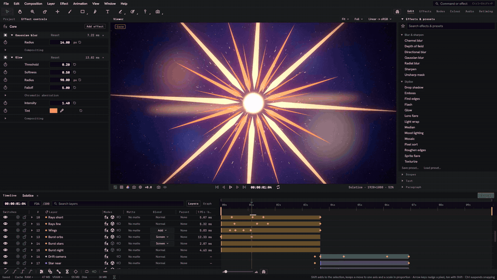
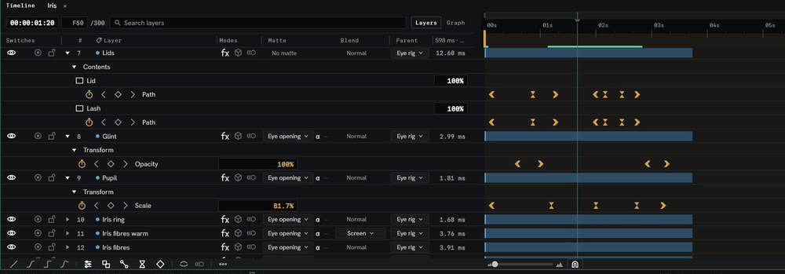
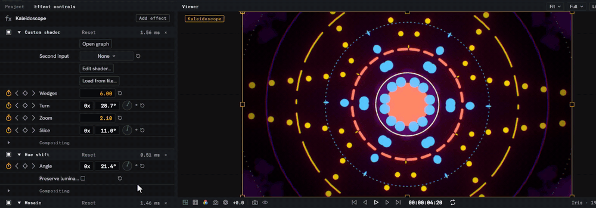
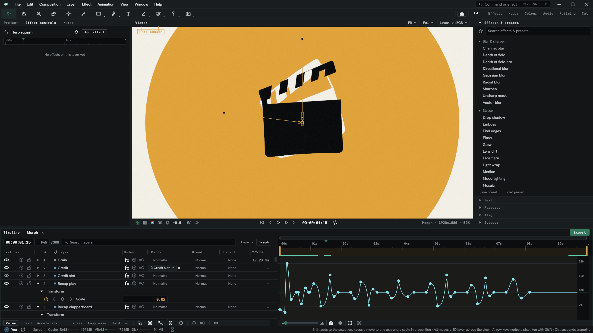
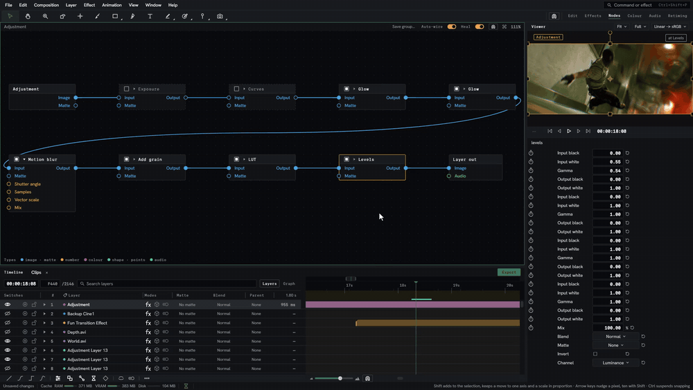
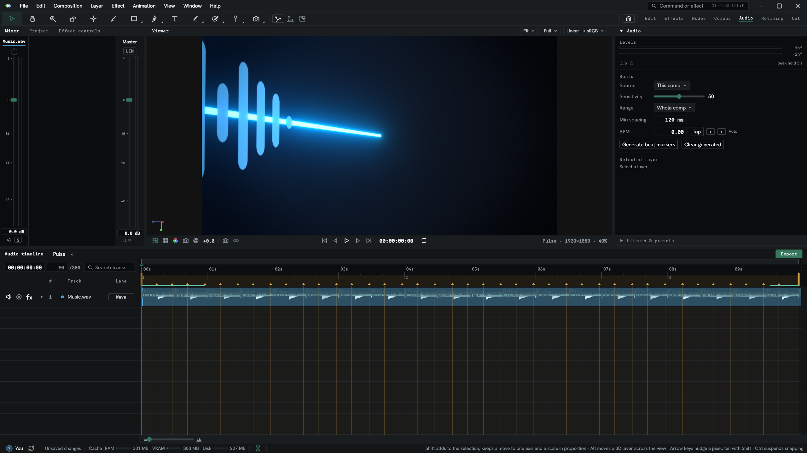
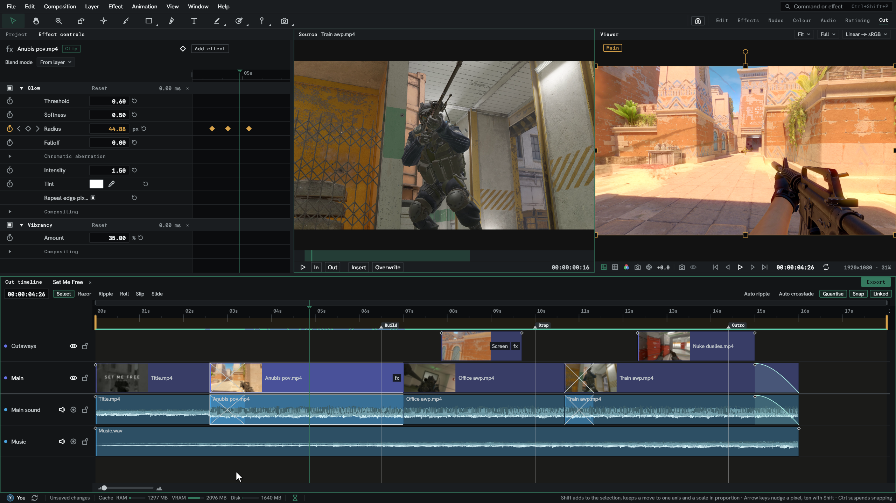
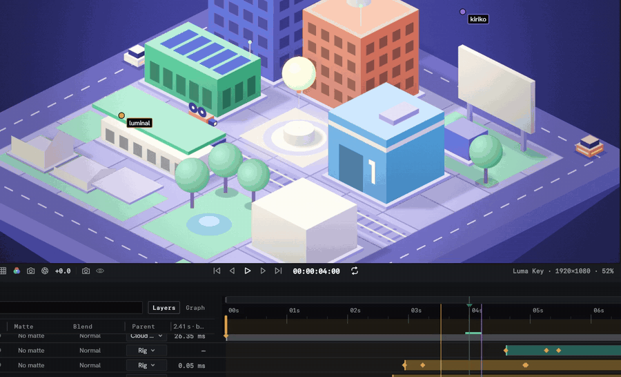

<p align="right"><a href="./README.md">English</a> | <b>简体中文</b></p>

<p align="center">
  <a href="https://lumitlab.com">
    <picture>
      <source media="(prefers-color-scheme: dark)" srcset="web/public/media/lumit-wordmark.svg">
      
    </picture>
  </a>
</p>

<p align="center">
  <b>适应你工作方式的合成软件。</b><br>
  一个适用于 Windows、macOS 和 Linux 的动态图形与合成编辑器。由剪辑师打造，为剪辑师而生。
</p>

<p align="center">
  <a href="https://github.com/luminalmvm/Lumit/releases/latest"></a>
  <a href="https://github.com/luminalmvm/Lumit/releases"></a>
  <a href="https://github.com/luminalmvm/Lumit/actions/workflows/ci.yml"></a>
  <a href="https://github.com/luminalmvm/Lumit/commits/main"></a>
  <a href="LICENSE"></a>
  <br>
  
  
  
  
  
  
</p>

<p align="center">
  <a href="https://lumitlab.com/download"></a>
  <a href="https://discord.gg/dc3p3XC7mM"></a>
</p>

<p align="center">
  <a href="https://lumitlab.com">官网</a> ·
  <a href="https://docs.lumitlab.com">手册</a> ·
  <a href="https://lumitlab.com/releases">版本发布</a> ·
  <a href="https://lumitlab.com/projects">示例项目</a> ·
  <a href="https://lumitlab.com/translate">参与翻译</a> ·
  <a href="https://github.com/sponsors/luminalmvm">赞助</a>
</p>

<p align="center">
  
</p>

> [!NOTE]
> Lumit 目前处于公开测试阶段。如果遇到问题或缺少功能，请[提交 issue](https://github.com/luminalmvm/Lumit/issues)，或者来 [Discord](https://discord.gg/dc3p3XC7mM) 告诉我们。

## 什么是 Lumit

Lumit 把 After Effects 和 Vegas 各自最好的部分整合进一个编辑器，合成、剪辑和变速都不用离开它。这个软件源于我在 After Effects 里做 frag 剪辑时的痛苦，大部分工作时间都花在了等预览上。所以它最主要的目标就是：不管项目里有多少图层和关键帧，软件都始终保持流畅。

它免费并开源，永远如此。没有订阅，没有按席位收费，基础功能也不用额外付钱。

## 用你熟悉的方式合成

面板、快捷键和关键帧的用法都和 After Effects 用户习惯的一致，而 Vegas 风格的变速只需一个开关。After Effects 项目可以直接在 Lumit 中打开，关键帧、基础效果，以及 Lumit 能找到的 OFX 插件都会一起带过来。

<p align="center">
  
</p>

效果可以由表达式驱动，可以在节点图里连线修改，也可以直接在效果控件里调整。

<p align="center">
  
</p>

## 功能一览

- **两种变速方式。** 在数值图表或速度图表上对图层进行 Retime，支持 After Effects 和 Vegas 两种风格，随时可以切换。
- **在一个图层内剪辑。** 序列图层可以在一行里首尾相接地放置片段，就像 NLE 一样，每个片段都保留自己的 Retime。
- **内置 100 多种效果。** 发光、运动模糊、抖动、RGB 分离、调色、Roto 画笔、木偶工具等等。每个效果都在 GPU 上渲染，并且在[手册](https://docs.lumitlab.com/effects/)里都有自己的页面。
- **OFX、CLAP 和 VST3 插件。** Sapphire、Twixtor 等插件会在启动时被找到，和内置效果放在一起。
- **3D、文本和形状。** 带摄像机和景深的 3D 图层、带动画器的文本图层，以及支持绘画的形状图层。
- **让音乐引导你。** 节拍检测会在音频上打好标记，剪辑和变速都会吸附到这些标记上，任何属性都可以由图层的声音驱动。
- **多人编辑同一个项目。** 一个人主持，最多 16 人加入，每个人的指针、播放头和选区都有自己的颜色。
- **崩溃也不会丢失工作。** 每一次编辑都会实时写入日志，如果 Lumit 在编辑中途关闭，下次打开时会把你的工作找回来。
- **界面始终流畅。** 遇到来不及渲染的帧时会降低预览质量而不是卡住，导出时也可以继续工作。
- **保留你的快捷键。** 加载 After Effects 的快捷键方案，或者读取 After Effects 保存的快捷键文件，让你自定义的按键也能带过来。
- **脚本、命令行和 MCP。** 可以用脚本、终端或 AI 工具来控制 Lumit。

## 工作区

每个工作区都为一种工作安排好了窗口布局，随时可以切换。

<table>
  <tr>
    <td width="50%"></td>
    <td width="50%"></td>
  </tr>
  <tr>
    <td><b>图表</b> - 属性的曲线，可以是数值图表或速度图表。</td>
    <td><b>节点</b> - 同样的效果，以连线链的形式呈现。</td>
  </tr>
  <tr>
    <td></td>
    <td></td>
  </tr>
  <tr>
    <td><b>音频</b> - 混音条、电平和节拍检测。</td>
    <td><b>剪切</b> - 轨道上的片段，查看器旁边是源视图。</td>
  </tr>
</table>

## 一起工作

<p align="center">
  
</p>

主持一个项目并发送邀请，每个人的编辑都会实时出现在所有人那里。[Lumit Pro](https://lumitlab.com/pro) 提供托管的中继服务，让你在任何地方都能一起工作，还有预览、备份和同步。编辑器本身始终免费。

## 下载

Windows、macOS 和 Linux（包括 Flatpak）的安装程序可以在 [lumitlab.com/download](https://lumitlab.com/download) 或[最新的 GitHub 发布](https://github.com/luminalmvm/Lumit/releases/latest)找到。Lumit 会自动检查并安装更新，也可以在你想要的时候再安装。

第一次使用？手册从[安装 Lumit 和你的第一个合成](https://docs.lumitlab.com/start/install/)开始。

## 翻译

所有翻译都来自社区。在[翻译页面](https://lumitlab.com/translate)选择一种语言，补上缺少的内容，然后把文件作为 issue 发回来就行。

<p>
  <a href="https://lumitlab.com/translate"></a>
  <a href="https://lumitlab.com/translate"></a>
  <a href="https://lumitlab.com/translate"></a>
  <a href="https://lumitlab.com/translate"></a>
  <a href="https://lumitlab.com/translate"></a>
  <a href="https://lumitlab.com/translate"></a>
  <a href="https://lumitlab.com/translate"></a>
  <a href="https://lumitlab.com/translate"></a>
  <a href="https://lumitlab.com/translate"></a>
  <a href="https://lumitlab.com/translate"></a>
</p>

## 从源码构建

引擎使用 Rust 和 wgpu，位于 `crates/`。界面使用 Flutter，位于 `flutter_ui/`，两者在 `crates/lumit-bridge` 连接。

需要 Rust 稳定版（由 `rust-toolchain.toml` 固定），用于媒体处理的 **FFmpeg 8.x**，以及用于绑定生成器的 **LLVM 18**。FFmpeg 必须是 8，用 7 或 9 构建会直接报错停止。较新的 LLVM 会静默生成有问题的绑定，因此 Windows 和 Linux 都固定在 18。

<details>
<summary><b>Windows</b></summary>

在 `%USERPROFILE%\ffmpeg\` 下解压一个 [BtbN FFmpeg 8.1 shared/GPL build](https://github.com/BtbN/FFmpeg-Builds/releases)，然后运行：

```powershell
winget install LLVM.LLVM --version 18.1.8
. .\scripts\win-dev-env.ps1 -Persist
cargo test --workspace
```
</details>

<details>
<summary><b>macOS</b></summary>

Homebrew 里不带版本号的 `ffmpeg` 已经是 9.x，所以要安装 `ffmpeg@8`。它不会被链接到 `PATH`，因此需要在构建所用的 shell 里把构建指向它：

```sh
brew install ffmpeg@8
export FFMPEG_PKG_CONFIG_PATH="$(brew --prefix ffmpeg@8)/lib/pkgconfig"
export PATH="$(brew --prefix ffmpeg@8)/bin:$PATH"   # 测试用 ffmpeg 命令行生成媒体文件
cargo test --workspace
```

Xcode 自带的 libclang 在这里可以直接使用，不需要另外安装 LLVM。
</details>

<details>
<summary><b>Linux</b></summary>

Ubuntu 26.04 自带 FFmpeg 8，所以只需要安装软件包：

```sh
sudo apt install pkg-config libclang-18-dev libasound2-dev libgl-dev libegl-dev \
  libxkbcommon-dev libxkbcommon-x11-dev libx11-dev libxcursor-dev libxi-dev \
  libxrandr-dev libxcb1-dev libwayland-dev \
  libavcodec-dev libavformat-dev libavutil-dev libswscale-dev libswresample-dev \
  libavfilter-dev libavdevice-dev
```

其他发行版自带的 FFmpeg 版本都不对（Debian 13 和较旧的 Ubuntu 是 7，Arch 是 9），所以不要安装发行版的 FFmpeg 开发包，改为解压一个 [BtbN FFmpeg 8.1 shared/GPL build](https://github.com/BtbN/FFmpeg-Builds/releases)：

```sh
# Arch / Artix: sudo pacman -S pkgconf clang18 llvm18
mkdir -p ~/ffmpeg8
# 和 CI 使用的是同一个带日期的构建，并用同一个哈希校验
f=ffmpeg-n8.1.2-50-g1a748fe2cd-linux64-gpl-shared-8.1.tar.xz
curl -fsSLO https://github.com/BtbN/FFmpeg-Builds/releases/download/autobuild-2026-08-31-13-27/$f
echo "35dc428bf78d3f8a4447a68707338ecf9560ebcc7459967974f9ff5b1f84be24  $f" | sha256sum -c -
tar -xJf $f -C ~/ffmpeg8 --strip-components=1
# .pc 文件里写的是构建它的那台机器上的 prefix
sed -i "s|^prefix=.*|prefix=$HOME/ffmpeg8|" ~/ffmpeg8/lib/pkgconfig/*.pc
export PKG_CONFIG_PATH="$HOME/ffmpeg8/lib/pkgconfig:$PKG_CONFIG_PATH"
export LD_LIBRARY_PATH="$HOME/ffmpeg8/lib:$LD_LIBRARY_PATH"
export PATH="$HOME/ffmpeg8/bin:$PATH"
```

然后在构建所用的 shell 里把构建指向 LLVM 18，因为这些发行版默认的 `clang` 都更新：

```sh
export LIBCLANG_PATH=/usr/lib/llvm-18/lib          # Arch: /usr/lib/llvm18/lib
cargo test --workspace
```
</details>

界面需要 Flutter SDK，见 [flutter_ui/README.md](flutter_ui/README.md)。

## 仓库结构

- [docs/GUIDE.md](docs/GUIDE.md) 是入门的地方：如何构建和运行、代码必须遵守的规则，以及每个 crate 的作用。
- [docs/](docs/) 包含术语表、架构、性能与工程规则，以及桥接约定。
- [crates/](crates/) 是引擎，一个 Cargo 工作区，[flutter_ui/](flutter_ui/) 是界面。
- [web/](web/) 和 [web-docs/](web-docs/) 是 [lumitlab.com](https://lumitlab.com) 和[手册](https://docs.lumitlab.com)，不依赖仓库中的其他任何内容。

## 参与贡献

欢迎提交 issue 和 PR。请先阅读 [docs/GUIDE.md](docs/GUIDE.md)，并在代码、界面文字和提交信息中使用 [docs/01-GLOSSARY.md](docs/01-GLOSSARY.md) 中规定的术语。合并前 CI 必须通过。

翻译不在这个仓库里进行，请使用[翻译页面](https://lumitlab.com/translate)，这里唯一编辑的语言文件是英式英语原文。

## 支持 Lumit

[在 GitHub 上赞助](https://github.com/sponsors/luminalmvm)、购买 [Lumit Pro](https://lumitlab.com/pro)，或者把它推荐给朋友。

## 许可证

[GPLv3](LICENSE)。所有衍生项目都必须保持开源。
