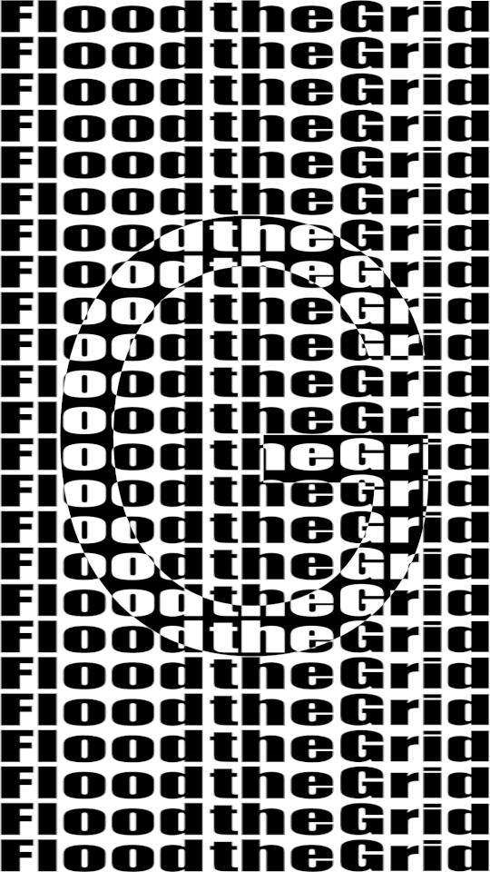
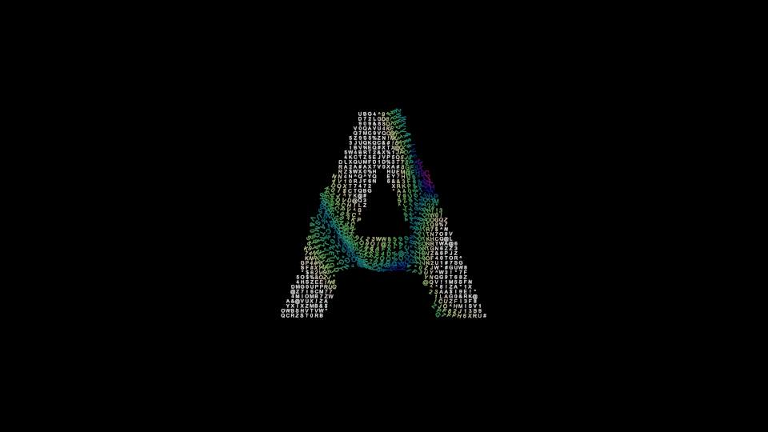

# SICELIOT

**Cavalry-style, non-destructive effects for [Lumit](https://github.com/luminalmvm/Lumit).**
**Effetti non distruttivi in stile Cavalry per [Lumit](https://github.com/luminalmvm/Lumit).**

This page is the whole project on one page: every effect, every change to Lumit's engine, and how
to add SICELIOT to your own Lumit. Effect and parameter names are in English, as in the program;
everything else is in English and Italian.

Questa pagina riassume tutto il progetto: ogni effetto, ogni modifica all'engine di Lumit e come
aggiungere SICELIOT al proprio Lumit. I nomi di effetti e parametri sono in inglese, come nel
programma; tutto il resto è in inglese e in italiano.

| | English | Italiano |
|---|---|---|
| Details of every parameter | [en/effects.md](en/effects.md) | [it/effetti.md](it/effetti.md) |
| Engine changes, file by file | [en/engine-changes.md](en/engine-changes.md) | [it/modifiche-engine.md](it/modifiche-engine.md) |
| Building on Windows | [en/building.md](en/building.md) | [it/compilazione.md](it/compilazione.md) |
| Cavalry vs Lumit research | [research/en/](research/en/cavalry-vs-lumit.md) | [research/it/](research/it/cavalry-vs-lumit.md) |

---

## 1. Effects / Effetti

SICELIOT has two headings in Lumit. **Siceliot FX** holds the picture effects: they change a
layer's pixels, stack on a layer like any other effect and have Mix, Blend and Matte rows. They come
from the LFX extension `siceliot` (version 1.3.0), except Type fill, which is in the engine.
**Siceliot Nodes** holds the drivers: they make a number, not a picture, live only in the Node
graph, and are wired into the parameters of any effect, much like Cavalry's Behaviours. Parameters,
examples of use and Cavalry equivalents: [en/effects.md](en/effects.md).

In Lumit SICELIOT ha due intestazioni. **Siceliot FX** contiene gli effetti di immagine: cambiano i
pixel di un layer, si impilano come ogni altro effetto e hanno le righe Mix, Blend e Matte. Vengono
dall'estensione LFX `siceliot` (versione 1.3.0), tranne Type fill, che è nell'engine. **Siceliot
Nodes** contiene i driver: producono un numero, non un'immagine, stanno solo nel Node graph e si
collegano ai parametri di qualsiasi effetto, come i Behaviour di Cavalry. Parametri, esempi d'uso ed
equivalenti in Cavalry: [it/effetti.md](it/effetti.md).

### Falloffs and gradients / Falloff e gradienti

| Effect | What it does | Cosa fa |
|---|---|---|
| **Falloff** | Draws where something should happen, from white (full) to black (none): Circle, Box, Linear or Sweep, with a curve, repetitions and Cavalry's Probability (Binary). Use it as the Matte of any effect, or to fade its own layer; several stack through their Blend row. | Disegna dove deve succedere qualcosa, dal bianco (pieno) al nero (niente): Circle, Box, Linear o Sweep, con curva, ripetizioni e la Probability di Cavalry (Binary). Si usa come Matte di qualsiasi effetto o per dissolvere il proprio layer; più Falloff si combinano con la riga Blend. |
| **Conical gradient** | A ramp between two circles, the Start circle growing into the End circle: radial, or off-centre for a light-inside-a-sphere look. | Una rampa tra due cerchi, il cerchio Start che cresce fino al cerchio End: radiale, oppure decentrata per l'effetto "luce dentro una sfera". |
| **Sweep gradient** | The ramp turns round a centre, like a radar or a colour wheel, over an Arc and with Repetitions. | La rampa gira attorno a un centro, come un radar o una ruota dei colori, su un Arc e con Repetitions. |
| **Multi-point gradient** | Up to six coloured points, each pulling the colours round it by its Influence. | Fino a sei punti colorati, ognuno attira i colori attorno a sé in base alla sua Influence. |
| **Gradient map** | Recolours the picture by brightness through a ramp of up to five colours. | Ricolora l'immagine in base alla luminosità con una rampa fino a cinque colori. |

### Patterns / Motivi

| Effect | What it does | Cosa fa |
|---|---|---|
| **Voronoi** | A cellular pattern: flat cells, distance shading or cell edges, with Evolution for seamless loops. | Un motivo a celle: celle piene, sfumatura per distanza o bordi delle celle, con Evolution per loop perfetti. |
| **Checkerboard** | Two colours in squares, any size and angle, with edges that do not shimmer. | Due colori a scacchi, di qualsiasi misura e angolo, con bordi che non sfarfallano. |
| **Halftone** | Redraws the picture as a printed screen of dots, lines or squares. | Ridisegna l'immagine come una retinatura di stampa a punti, linee o quadrati. |
| **Dithering** | Fewer colours, with the steps broken into an 8 × 8 Bayer or a noise pattern; colour or two-tone. | Meno colori, con i passaggi spezzati in una trama Bayer 8 × 8 o di rumore; a colori o a due toni. |

### Light, shadow and edges / Luce, ombre e bordi

| Effect | What it does | Cosa fa |
|---|---|---|
| **Inner shadow** | A soft shadow inside the layer's edges, blurred at half size so it stays light on modest machines. | Un'ombra morbida dentro i bordi del layer, sfocata a metà risoluzione per restare leggera anche su PC modesti. |
| **Erosion** | Shrinks the layer's shape (choke) or grows it (spread) by up to 64 px. | Restringe (choke) o allarga (spread) la forma del layer fino a 64 px. |
| **Light sweep** | A soft band of light across the layer; keyframe Centre to sweep it. | Una fascia di luce morbida sul layer; anima Centre per farla scorrere. |
| **Lighting** | Long shadows from a point or directional light, and the light brightening the layer. | Ombre lunghe da una luce puntiforme o direzionale, e la luce che schiarisce il layer. |

### Streaks, blur and warps / Strisce, sfocature e deformazioni

| Effect | What it does | Cosa fa |
|---|---|---|
| **Stripes** | Repeats a band of pixels through a line, pulling the line out into streaks. | Ripete una fascia di pixel lungo una linea, tirandola fuori in strisce. |
| **Scrape** | Drags a line of pixels out to one side, fading, with rough ends. | Trascina una linea di pixel da un lato, sfumandola, con estremità irregolari. |
| **Bilateral blur** | Smooths areas of similar colour and keeps the edges between them sharp. | Ammorbidisce le zone di colore simile e mantiene netti i bordi tra loro. |
| **Bend** | Curls the picture round a circle from a centre, along an angle. | Arrotola l'immagine attorno a un cerchio a partire da un centro, lungo un angolo. |
| **Wave** | A sine, triangle, square or sawtooth wave pushes the picture sideways, with speed or an exact-loop phase. | Un'onda sinusoidale, triangolare, quadra o a dente di sega spinge l'immagine di lato, con velocità o fase per un loop perfetto. |
| **Four point warp** | Pins the layer's four corners to four points and bows each edge in or out. | Fissa i quattro angoli del layer su quattro punti e curva ogni bordo verso l'interno o l'esterno. |

### Drivers (in the engine) / Driver (nell'engine)

Drivers make a **number**, not a picture. Add them in a layer's **Node graph** (`Ctrl+Space`,
heading **Siceliot Nodes**) and wire **Value** into any parameter. Wired into **Clone to points'** own
**Scale**, **Rotation** or **Opacity**, they give every copy its own value, like Cavalry's
behaviours on a Duplicator.

I driver producono un **numero**, non un'immagine. Si aggiungono nel **Node graph** del layer
(`Ctrl+Space`, intestazione **Siceliot Nodes**) e si collega **Value** a qualsiasi parametro. Collegati a
**Scale**, **Rotation** o **Opacity** di **Clone to points**, danno a ogni copia il suo valore, come i
behaviour di Cavalry su un Duplicator.

| Driver | What it does | Cosa fa |
|---|---|---|
| **Stagger** | Steps from Minimum on the first copy to Maximum on the last, through a Curve, with Offset, Loop and Reverse. | Va da Minimum sulla prima copia a Maximum sull'ultima, seguendo una Curve, con Offset, Loop e Reverse. |
| **Random** | A random value per copy, the same every frame, with Bias, and new values at a Rate if wanted. | Un valore casuale per copia, uguale in ogni frame, con Bias, e nuovi valori a una certa Rate se serve. |
| **Oscillator** | A wave between Minimum and Maximum over time. Its phase comes from the copy's number (Phase per copy) or from where the copy stands (Phase from = Position, Wave angle, Wavelength), so a wave can cross the copies like a texture. | Un'onda tra Minimum e Maximum nel tempo. La fase dipende dal numero della copia (Phase per copy) o da dove si trova (Phase from = Position, Wave angle, Wavelength), così un'onda può attraversare le copie come una texture. |
| **Value noise** | A value that wanders smoothly. Vary by: Nothing, Copy, or Position (a field of noise laid over the copies, Noise scale). | Un valore che vaga in modo morbido. Vary by: Nothing, Copy, oppure Position (un campo di rumore steso sulle copie, Noise scale). |
| **Ring wave** | Rings that grow out one after another from random places (Interval, Speed, Thickness, Origin). Origin Away from points keeps rings off the shape the points fill; Add up lets overlaps pass full. Four outputs: Value (how strong the rings are on a point), Rotation (the turn they give), Passes (how many have crossed the point) and Grow (each ring's own push). | Anelli che si allargano uno dopo l'altro da punti a caso (Interval, Speed, Thickness, Origin). Origin Away from points tiene gli anelli fuori dalla forma riempita dai punti; Add up lascia che le sovrapposizioni superino il pieno. Quattro uscite: Value (quanto sono forti gli anelli su un punto), Rotation (la rotazione che danno), Passes (quanti hanno attraversato il punto) e Grow (la spinta di ogni anello). |

Rows a mode does not read are greyed out (for example Wave angle while Phase from is Copy).
Le righe che una modalità non usa diventano grigie (per esempio Wave angle con Phase from su Copy).

### Lumit effects SICELIOT extends / Effetti di Lumit estesi da SICELIOT

| Effect | What SICELIOT adds | Cosa aggiunge SICELIOT |
|---|---|---|
| **Label points** | Random text at every point (`{pick:a\|b\|c}`, `{chars:N}`, `{hex:N}`, Seed). Labels react to a driver wired into **Change**: they scramble, change for good with **Text step**, take colour (**Flash colour**: Random hue, Two colours, By strength, Gradient), grow (**Label scale**, **Grow**) and turn (**Label rotation**). See [en/effects.md](en/effects.md#label-points). | Testo casuale su ogni punto (`{pick:a\|b\|c}`, `{chars:N}`, `{hex:N}`, Seed). Le etichette reagiscono a un driver collegato a **Change**: cambiano testo, lo cambiano per sempre con **Text step**, prendono colore (**Flash colour**: Random hue, Two colours, By strength, Gradient), si ingrandiscono (**Label scale**, **Grow**) e ruotano (**Label rotation**). Vedi [it/effetti.md](it/effetti.md#label-points). |
| **Type fill** (new, Siceliot FX) | Rows of **Words** (`Flood|the|Grid`) cut into columns; each keeps the stretches a **Region layer** leaves free (or fills, with **Invert region**) and stretches its word to fill them. Look from a **Text layer**. See [en/effects.md](en/effects.md#type-fill). | Righe di **Words** divise in colonne; ognuna tiene i tratti lasciati liberi da un **Region layer** (o occupati, con **Invert region**) e vi allunga la sua parola. Aspetto da un **Text layer**. Vedi [it/effetti.md](it/effetti.md#type-fill). |
| **Clone to points** | Scale, Rotation and Opacity per copy from SICELIOT's drivers (and Clone index). | Scale, Rotation e Opacity per copia dai driver SICELIOT (e da Clone index). |

---

### Example projects / Progetti di esempio

Two projects in `examples\`. Details: [en/examples.md](en/examples.md).

Due progetti in `examples\`. Dettagli: [it/esempi.md](it/esempi.md).

| Flood | Sketch |
|---|---|
|  |  |
| After *Submesh Boolean* by Tim Siegert (CC BY-NC 4.0): rows of "Flood the Grid" that stretch around animated shapes, black outside and white inside, with two **Type fill** effects on one precomp of Falloff shapes. *Righe di parole che si allungano attorno a forme animate, nere fuori e bianche dentro.* | After the Processing sketch "lettere su lettere": a giant "A" of small characters crossed by rings that colour, enlarge, turn and change them (Grid, Pick points, Label points, Ring wave, Value noise). *Una "A" gigante di piccoli caratteri attraversata da anelli che li colorano, ingrandiscono, ruotano e cambiano.* |

## 2. Engine changes / Modifiche all'engine

SICELIOT changes Lumit in fourteen steps, fourteen commits on the branch `siceliot/lumit-0.10` in `Lumit`
and fourteen patches in [`patches/`](../patches/README.md), on top of upstream Lumit `v0.10.0`. Every step is
tested; the details are in [en/engine-changes.md](en/engine-changes.md) /
[it/modifiche-engine.md](it/modifiche-engine.md).

SICELIOT modifica Lumit in quattordici passi, quattordici commit sul ramo `siceliot/lumit-0.10` in `Lumit` e
quattordici patch in [`patches/`](../patches/README.md), sopra Lumit originale `v0.10.0`. Ogni passo è
verificato; i dettagli sono in [en/engine-changes.md](en/engine-changes.md) /
[it/modifiche-engine.md](it/modifiche-engine.md).

| # | Patch | What it changes | Cosa cambia |
|---|---|---|---|
| 1 | `0001` | A category of Siceliot's own (shown as **Siceliot FX**), accepted in LFX manifests. | Una categoria tutta di Siceliot (mostrata come **Siceliot FX**), accettata nei manifest LFX. |
| 2 | `0002` | The four drivers; a drivers category (**Siceliot Nodes**) that behaves exactly as Lumit's Drivers (`FxCategory::is_driver`); Clone to points renders per copy when it finds one. | I quattro driver; una categoria di driver (**Siceliot Nodes**) che si comporta esattamente come i Drivers di Lumit (`FxCategory::is_driver`); Clone to points renderizza per copia quando ne trova uno. |
| 3 | `0003` | Drivers wired into Clone to points' Scale, Rotation or Opacity give each stamp its own value, turned and sized whole, never cropped. | I driver collegati a Scale, Rotation o Opacity di Clone to points danno a ogni timbro il suo valore, ruotato e scalato per intero, mai ritagliato. |
| 4 | `0004` | Drivers know where each copy stands; Oscillator (Phase from) and Value noise (Vary by) can vary by position. | I driver sanno dove si trova ogni copia; Oscillator (Phase from) e Value noise (Vary by) possono variare in base alla posizione. |
| 5 | `0005` | Rows a driver mode does not read are greyed out; Label points gains random text tokens `{pick:…}`, `{chars:N}`, `{hex:N}` and a Seed. | Le righe che una modalità dei driver non usa diventano grigie; Label points riceve i segnaposto di testo casuale `{pick:…}`, `{chars:N}`, `{hex:N}` e un Seed. |
| 6 | `0006` | Decode: Label points' Change, Change above, Scramble rate, Flash colour (Colour A, Colour B) and Label scale; drivers wired into Change and Label scale act per point. | Decode: Change, Change above, Scramble rate, Flash colour (Colour A, Colour B) e Label scale in Label points; i driver collegati a Change e Label scale agiscono per punto. |
| 7 | `0007` | The Ring wave driver; Label points draws each label between pixels at any size and turn, and gains Text step, Flash colour By strength (Hue start, Hue range, Saturation, Darken), Grow and Label rotation. | Il driver Ring wave; Label points disegna ogni etichetta tra un pixel e l'altro a qualunque dimensione e rotazione, e riceve Text step, Flash colour By strength (Hue start, Hue range, Saturation, Darken), Grow e Label rotation. |
| 8 | `0008` | Closer to the Processing sketch: Flash colour **Gradient** (up to four chosen colours) and **Vertical anchor** on Label points; Ring wave origins **Away from points**, **Add up** and a per-ring **Grow** output. | Più vicino allo sketch Processing: Flash colour **Gradient** (fino a quattro colori a scelta) e **Vertical anchor** in Label points; origini **Away from points** del Ring wave, **Add up** e un'uscita **Grow** per anello. |
| 9 | `0009` | Effects copied in Effect Controls paste with the drivers and wires that feed them, so a wired rig works on another layer. | Gli effetti copiati in Effect Controls si incollano con i driver e i collegamenti che li pilotano, così un sistema collegato funziona su un altro layer. |
| 10 | `0010` | **Type fill**: rows of words that stretch to fill the room a Region layer leaves, inside or outside it. | **Type fill**: righe di parole che si allungano per riempire lo spazio lasciato da un Region layer, dentro o fuori. |
| 11 | `0011` | The name is written Siceliot, and two headings: **Siceliot FX** (picture effects, used like any effect) and **Siceliot Nodes** (drivers, only in the Node graph). LFX manifests say `"Siceliot FX"`; `"SICELIOT"` still works. | Il nome si scrive Siceliot, e due intestazioni: **Siceliot FX** (effetti di immagine, usati come ogni effetto) e **Siceliot Nodes** (driver, solo nel Node graph). I manifest LFX dicono `"Siceliot FX"`; `"SICELIOT"` funziona ancora. |
| 12 | `0012` | Type fill gives each word once per column: a shape that cuts a column in two cuts its word ("t" on one side, "he" on the other) instead of showing it again. New **Cut words**: words stay whole and the shape's edge cuts them, white inside, black outside. Either way the shape's edge cuts the words pixel by pixel. | Type fill dà ogni parola una volta per colonna: una forma che taglia una colonna in due taglia la sua parola ("t" da una parte, "he" dall'altra) invece di ripeterla. Nuovo **Cut words**: le parole restano intere e il bordo della forma le taglia, bianche dentro, nere fuori. In ogni caso il bordo della forma taglia le parole pixel per pixel. |
| 13 | `0013` | An LFX effect whose manifest says `"backdrop": true` works straight on a layer with a picture: the layer is drawn as an adjustment over what is below, and its own picture is the effect's shape. Reaizzi Glass on a PNG or a shape bends what is behind it, with no adjustment layer to make and no layer to pick. | Un effetto LFX il cui manifest dice `"backdrop": true` funziona direttamente su un livello con un'immagine: il livello è disegnato come una regolazione sopra ciò che sta sotto, e la sua immagine è la forma dell'effetto. Reaizzi Glass su un PNG o una shape piega ciò che c'è dietro, senza livello di regolazione da creare né livello da scegliere. |
| 14 | `0014` | A shader row annotation, `@enabled_if`, greys the rows that do nothing as things stand. Reaizzi Glass on a PNG or shape greys the built-in shape's rows (Centre, Width, Height, Corner radius, Shape rotation), since the layer gives the shape; Shape channel greys when no layer does, Corner radius on an ellipse, Rim width with Edge highlight off. | Un'annotazione delle righe dello shader, `@enabled_if`, mette in grigio le righe che nella situazione attuale non fanno nulla. Reaizzi Glass su un PNG o una shape mette in grigio le righe della forma integrata (Centre, Width, Height, Corner radius, Shape rotation), perché la forma la dà il livello; Shape channel va in grigio quando nessun livello dà la forma, Corner radius con l'ellisse, Rim width con Edge highlight spento. |

---

## 3. How to add SICELIOT to Lumit (English)

The official Lumit does not have the Siceliot headings or drivers yet, so SICELIOT needs **a Lumit
built from source with the patches**, plus the **extension**. The steps are for Windows; macOS and
Linux follow Lumit's own `docs/GUIDE.md` with the same patches.

### 3.1 Install the tools (once)

From PowerShell:

```powershell
winget install Git.Git
winget install Rustlang.Rustup
winget install LLVM.LLVM --version 18.1.8
winget install Microsoft.VisualStudio.2022.BuildTools --override "--wait --quiet --add Microsoft.VisualStudio.Workload.VCTools --includeRecommended"
```

Then:

1. **FFmpeg 8.1:** download `ffmpeg-n8.1-latest-win64-gpl-shared-8.1.zip` from
   [BtbN/FFmpeg-Builds](https://github.com/BtbN/FFmpeg-Builds/releases) and unzip it into
   `%USERPROFILE%\ffmpeg\`.
2. **Flutter 3.47.1 (stable):** download it from [flutter.dev](https://docs.flutter.dev/release/archive)
   and unzip it, for example to `C:\flutter`.
3. **Developer Mode:** *Settings ▸ System ▸ For developers* ▸ on.
4. **Environment variables** (user): `FFMPEG_LIBS_DIR` = `…\ffmpeg-n8.1-latest-win64-gpl-shared-8.1\lib`,
   `FFMPEG_INCLUDE_DIR` = `…\include`, `LIBCLANG_PATH` = the `bin` folder of LLVM; add FFmpeg's
   `bin` and Flutter's `bin` to `Path`. Open a new PowerShell afterwards.

### 3.2 Get Lumit and apply the patches

```powershell
git clone https://github.com/luminalmvm/Lumit
cd Lumit
git config user.name "Your name"
git config user.email "you@example.com"
git switch -c siceliot v0.10.0
git am path\to\Siceliot\patches\*.patch
```

`git am` records the patches as commits, so Git needs a name and an email (the two `config`
lines, for this folder only).

`v0.10.0` is the Lumit version the patches are made for (Lumit 0.10.0). On a newer Lumit,
try `git am --3way`; if a patch does not apply, stay on `v0.10.0`.

### 3.3 Build

```powershell
cd flutter_ui
flutter build windows --release
```

The first build takes about 10 minutes. The app is in
`flutter_ui\build\windows\x64\runner\Release`. Copy the `.dll` files from FFmpeg's `bin` folder
into its `lib` folder, so it starts without FFmpeg on `Path`. Start `lumit.exe` from there.

If Flutter says *"Unable to find suitable Visual Studio toolchain"* and your Program Files are not
on `C:`, run `${env:ProgramFiles(x86)} = 'C:\Program Files (x86)'` in that PowerShell first.

### 3.4 Install the effects

In the Lumit you just built: *Settings ▸ Addons ▸ Extensions ▸ Install from a folder* and pick
`extensions\siceliot`, or install the package `dist\siceliot.lfx`. The **Siceliot FX** heading then
appears in Effects & presets. The five drivers need no install: they are in the engine.

### 3.5 Good to know

- Your **official** Lumit stays as it is. The built Lumit uses the same user folders (preferences,
  presets, extensions); set `LUMIT_USER_DIRS` to another folder before starting it to keep them
  apart.
- A project that uses SICELIOT should still open in the official Lumit: Lumit keeps effects it
  does not know as placeholders with their values, and they draw nothing. Back in a SICELIOT
  build they should work again. (Not yet tested with SICELIOT projects.)
- Sharing your build with others is allowed: Lumit is GPLv3, so whoever receives it must also be
  able to get the source, which is upstream Lumit plus these patches.

---

## 4. Come aggiungere SICELIOT a Lumit (italiano)

Il Lumit ufficiale non ha ancora le intestazioni Siceliot e i driver, quindi SICELIOT richiede **un
Lumit compilato dal sorgente con le patch**, più l'**estensione**. I passi sono per Windows; su
macOS e Linux si segue `docs/GUIDE.md` di Lumit con le stesse patch.

### 4.1 Installare gli strumenti (una volta)

Da PowerShell:

```powershell
winget install Git.Git
winget install Rustlang.Rustup
winget install LLVM.LLVM --version 18.1.8
winget install Microsoft.VisualStudio.2022.BuildTools --override "--wait --quiet --add Microsoft.VisualStudio.Workload.VCTools --includeRecommended"
```

Poi:

1. **FFmpeg 8.1:** scarica `ffmpeg-n8.1-latest-win64-gpl-shared-8.1.zip` da
   [BtbN/FFmpeg-Builds](https://github.com/BtbN/FFmpeg-Builds/releases) ed estrailo in
   `%USERPROFILE%\ffmpeg\`.
2. **Flutter 3.47.1 (stable):** scaricalo da [flutter.dev](https://docs.flutter.dev/release/archive)
   ed estrailo, per esempio in `C:\flutter`.
3. **Modalità sviluppatore:** *Impostazioni ▸ Sistema ▸ Per sviluppatori* ▸ attiva.
4. **Variabili d'ambiente** (utente): `FFMPEG_LIBS_DIR` = `…\ffmpeg-n8.1-latest-win64-gpl-shared-8.1\lib`,
   `FFMPEG_INCLUDE_DIR` = `…\include`, `LIBCLANG_PATH` = la cartella `bin` di LLVM; aggiungi a
   `Path` la cartella `bin` di FFmpeg e quella di Flutter. Poi apri una nuova finestra di
   PowerShell.

### 4.2 Scaricare Lumit e applicare le patch

```powershell
git clone https://github.com/luminalmvm/Lumit
cd Lumit
git config user.name "Il tuo nome"
git config user.email "tu@example.com"
git switch -c siceliot v0.10.0
git am percorso\di\Siceliot\patches\*.patch
```

`git am` registra le patch come commit, quindi Git vuole un nome e un'email (le due righe
`config`, solo per questa cartella).

`v0.10.0` è la versione di Lumit per cui sono fatte le patch (Lumit 0.10.0). Su un Lumit più
recente prova `git am --3way`; se una patch non si applica, resta su `v0.10.0`.

### 4.3 Compilare

```powershell
cd flutter_ui
flutter build windows --release
```

La prima compilazione richiede circa 10 minuti. L'app si trova in
`flutter_ui\build\windows\x64\runner\Release`. Copia i file `.dll` della cartella `bin` di FFmpeg
nella sua cartella `lib`, così parte anche senza FFmpeg nel `Path`. Avvia `lumit.exe` da lì.

Se Flutter risponde *"Unable to find suitable Visual Studio toolchain"* e i tuoi Programmi non
sono su `C:`, esegui prima `${env:ProgramFiles(x86)} = 'C:\Program Files (x86)'` nella stessa
finestra di PowerShell.

### 4.4 Installare gli effetti

Nel Lumit appena compilato: *Settings ▸ Addons ▸ Extensions ▸ Install from a folder* e scegli
`extensions\siceliot`, oppure installa il pacchetto `dist\siceliot.lfx`. Nel pannello Effects &
presets compare l'intestazione **Siceliot FX**. I cinque driver non vanno installati: sono
nell'engine.

### 4.5 Da sapere

- Il Lumit **ufficiale** resta com'è. Il Lumit compilato usa le stesse cartelle utente
  (preferenze, preset, estensioni); per tenerle separate imposta `LUMIT_USER_DIRS` su un'altra
  cartella prima di avviarlo.
- Un progetto che usa SICELIOT dovrebbe aprirsi anche nel Lumit ufficiale: Lumit tiene gli effetti
  che non conosce come segnaposto con i loro valori, e non disegnano nulla. In un Lumit con
  SICELIOT dovrebbero tornare a funzionare. (Non ancora provato con progetti SICELIOT.)
- Puoi condividere il tuo Lumit compilato: Lumit è GPLv3, quindi chi lo riceve deve poter avere
  anche il sorgente, cioè Lumit originale più queste patch.

---

## 5. Limits / Limiti

| | English | Italiano |
|---|---|---|
| Official Lumit | SICELIOT works only in a Lumit built with the patches, until they are accepted upstream. | SICELIOT funziona solo in un Lumit compilato con le patch, finché non vengono accettate dallo sviluppatore. |
| Scripts | `lumit.effect.set` cannot set an LFX effect's own rows; use Effect controls, keyframes or expressions. | `lumit.effect.set` non imposta le righe proprie di un effetto LFX; usa Effect controls, keyframe o espressioni. |
| Layer edges | An LFX effect cannot draw past its layer's picture (Erosion's spread, Inner shadow, Lighting's shadows). | Un effetto LFX non disegna oltre l'immagine del suo layer (spread di Erosion, Inner shadow, ombre di Lighting). |
| Warps | Bend, Wave and Four point warp move pixels, not paths. | Bend, Wave e Four point warp spostano pixel, non tracciati. |
| Copies | Per-copy values are computed for up to 4096 points; the cloned layer itself renders at most 32 different copies (Lumit's limit). | I valori per copia si calcolano fino a 4096 punti; il layer clonato stesso si renderizza al massimo in 32 copie diverse (limite di Lumit). |
| Position | Phase from / Vary by = Position need the driver wired into Clone to points' own Scale, Rotation or Opacity. | Phase from / Vary by = Position richiedono il driver collegato a Scale, Rotation o Opacity di Clone to points. |
| Labels | Labels are sized and turned by Label points' own Label scale, Grow and Label rotation; Clone to points' per-copy Scale and Rotation do not reach them. Label points draws at most 2000 labels, laid out on the processor. | Le etichette si ridimensionano e ruotano con Label scale, Grow e Label rotation di Label points; Scale e Rotation per copia di Clone to points non le raggiungono. Label points disegna al massimo 2000 etichette, composte sul processore. |
| Not yet | Geometric deformers, new distributions (Rose, Math), arrays by index, physics: they need further engine work. | Deformer geometrici, nuove distribuzioni (Rose, Math), array per indice, fisica: richiedono altro lavoro sull'engine. |
