# Effetti e nodi Siceliot

*English: [../en/effects.md](../en/effects.md)*

Per ogni effetto e nodo Siceliot: cosa fa, i suoi parametri, un esempio d'uso e a cosa corrisponde
in Cavalry. Nomi ed etichette dei parametri sono scritti esattamente come in Lumit, cioè in inglese.
Tutti richiedono il Lumit modificato: per installarlo vedi [../SICELIOT.md](../SICELIOT.md).

## Siceliot FX e Siceliot Nodes

In Lumit SICELIOT divide il suo lavoro in due intestazioni.

| | **Siceliot FX** | **Siceliot Nodes** |
|---|---|---|
| Cosa sono | Effetti di immagine | Driver |
| Cosa producono | Un'immagine: cambiano i pixel del layer | Un numero, che può cambiare nel tempo, per copia e per punto |
| Dove si trovano | Menu Add effect, Effects & presets, ricerca dei nodi | Solo nel Node graph del layer (`Ctrl+Space`) |
| Come si usano | Si aggiungono a un layer. Si impilano in ordine, ognuno lavora sull'immagine di quello sopra, e le loro righe compaiono in Effect controls | Si collega una delle loro prese di uscita (**Value**…) alla presa di un parametro. Il parametro segue il nodo invece dei suoi keyframe |
| Righe Mix, Blend, Matte | Sì | No: non disegnano niente |
| Per copia | La stessa immagine su ogni copia | Ogni copia di Clone to points, o ogni etichetta di Label points, può avere il suo valore |
| Come sono fatti | 19 shader dall'estensione LFX **Siceliot** (`id: siceliot`, versione 1.3.0, `extensions\siceliot`), più Type fill nell'engine | Nell'engine (vedi [modifiche-engine.md](modifiche-engine.md)) |
| In Cavalry | Shader, Filter e Deformer | Behaviour di valore |

In breve, un FX decide *cosa* si vede e un nodo decide *quanto*. Un nodo può pilotare qualsiasi
parametro di qualsiasi effetto, di Siceliot o di Lumit. Una riga di un FX si può animare con
keyframe, impostare con un'espressione o collegare a un nodo.

## Tutti gli effetti e i nodi

| Nome | Intestazione | Equivalente Cavalry | Match name |
|---|---|---|---|
| [Falloff](#falloff) | FX | Falloff (Circle, Rectangle, Linear, Sweep, Probability) | `lfx:siceliot/falloff` |
| [Conical gradient](#conical-gradient) | FX | Gradient Shader, Conical | `lfx:siceliot/conical-gradient` |
| [Sweep gradient](#sweep-gradient) | FX | Gradient Shader, Sweep | `lfx:siceliot/sweep-gradient` |
| [Multi-point gradient](#multi-point-gradient) | FX | Multi-Point Gradient Shader | `lfx:siceliot/multi-point-gradient` |
| [Gradient map](#gradient-map) | FX | Gradient Map Filter | `lfx:siceliot/gradient-map` |
| [Voronoi](#voronoi) | FX | Voronoi Shader | `lfx:siceliot/voronoi` |
| [Checkerboard](#checkerboard) | FX | Checkerboard Shader | `lfx:siceliot/checkerboard` |
| [Halftone](#halftone) | FX | Halftone Filter | `lfx:siceliot/halftone` |
| [Dithering](#dithering) | FX | Dithering Filter | `lfx:siceliot/dithering` |
| [Inner shadow](#inner-shadow) | FX | Inner Shadow Filter | `lfx:siceliot/inner-shadow` |
| [Erosion](#erosion) | FX | Erosion Filter | `lfx:siceliot/erosion` |
| [Light sweep](#light-sweep) | FX | Light Sweep Filter | `lfx:siceliot/light-sweep` |
| [Lighting](#lighting) | FX | Lighting Filter | `lfx:siceliot/lighting` |
| [Stripes](#stripes) | FX | Stripes Filter | `lfx:siceliot/stripes` |
| [Scrape](#scrape) | FX | Scrape Filter | `lfx:siceliot/scrape` |
| [Bilateral blur](#bilateral-blur) | FX | Bilateral Blur Filter | `lfx:siceliot/bilateral-blur` |
| [Bend](#bend) | FX | Bend Deformer (sui pixel) | `lfx:siceliot/bend` |
| [Wave](#wave) | FX | Wave Deformer (sui pixel) | `lfx:siceliot/wave` |
| [Four point warp](#four-point-warp) | FX | Four Point Warp (sui pixel) | `lfx:siceliot/four-point-warp` |
| [Type fill](#type-fill) | FX (engine) | Nessun nodo unico: la scena *Submesh Boolean* | `siceliot_type_fill` |
| [Stagger](#stagger) | Nodes | Behaviour Stagger | `siceliot_stagger` |
| [Random](#random) | Nodes | Behaviour Random | `siceliot_random` |
| [Oscillator](#oscillator) | Nodes | Behaviour Oscillator | `siceliot_oscillator` |
| [Value noise](#value-noise) | Nodes | Behaviour Noise | `siceliot_noise` |
| [Ring wave](#ring-wave) | Nodes | Nessuno | `siceliot_ring_wave` |
| [Clone to points](#clone-to-points) | di Lumit, esteso | Duplicator | |
| [Label points](#label-points) | di Lumit, esteso | Text Shape su un Duplicator | |

## Righe in più di ogni effetto Siceliot FX

Lumit le aggiunge a ogni effetto, sotto le sue righe, nel gruppo **Compositing**:

| Riga | Cosa fa |
|---|---|
| **Mix** | Quanto il risultato sostituisce l'immagine (da 0 a 100 %) |
| **Blend** | Come il risultato si fonde con l'immagine: Normal, Multiply, Screen, Add, Subtract, Overlay… |
| **Matte**, **Invert**, **Channel** | Un altro layer la cui luminosità decide dove agisce l'effetto |

I punti sono in **pixel alla dimensione della composizione**, misurati dall'angolo in alto a
sinistra del layer. I valori predefiniti sono pensati per un layer 1920 × 1080.

---

## Falloff

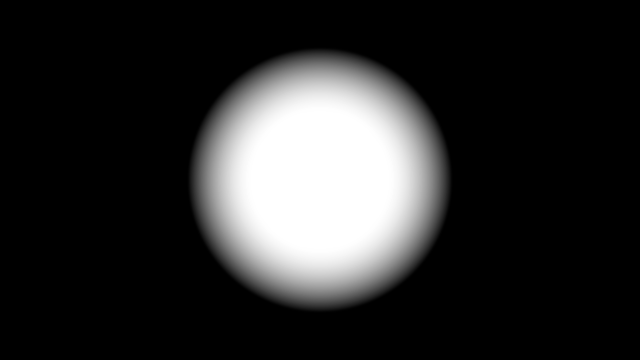

Disegna *dove* deve succedere qualcosa, dal bianco (pieno) al nero (niente), come fa il Falloff di
Cavalry per i Behaviour. Si usa in tre modi:

- **Come matte:** metti Falloff su un layer a parte (Output *Greyscale*), nascondi quel layer e
  sceglilo come **Matte** di qualsiasi effetto su un altro layer. L'effetto agisce solo dentro il
  falloff.
- **Sul proprio layer:** Output *Fade layer* dissolve l'immagine del layer secondo il falloff.
- **Impilato:** più Falloff sullo stesso layer si combinano con la riga **Blend**, come i layer
  mode dei falloff di Cavalry. *Multiply* tiene solo dove ci sono entrambi, *Screen* o *Add* li
  unisce, *Subtract* toglie uno dall'altro.

| Parametro | Controllo | Intervallo | Predefinito | Unità |
|---|---|---|---|---|
| **Shape** | Menu | Circle · Box · Linear · Sweep | Circle | |
| **Centre X**, **Centre Y** | Punto | qualsiasi | 960, 540 | px |
| **Width** | Slider | da 0 a 4000 | 800 | px |
| **Height** | Slider | da 0 a 4000 | 800 | px |
| **Rotation** | Manopola | qualsiasi angolo | 0 | ° |
| **Softness** | Slider | da 0 a 100 | 50 | % |
| **Arc** | Slider | da 1 a 360 | 360 | ° |
| **Repetitions** | Numero intero | da 1 a 64 | 1 | |
| **Curve** | Menu | Linear · Smooth · Ease in · Ease out · Bell | Smooth | |
| **Strength** | Slider | da 0 a 100 | 100 | % |
| **Invert falloff** | Casella | | No | |
| **Binary** | Casella | | No | |
| **Cell size** | Slider | da 1 a 200 | 20 | px |
| **Seed** | Seed | qualsiasi | | |
| **Output** | Menu | Greyscale · Alpha · Fade layer | Greyscale | |

- **Shape.** *Circle* e *Box* sono pieni al centro e sfumano verso il bordo per una fascia pari a
  **Softness** (un'ellisse o un rettangolo Width × Height). *Linear* va da pieno a niente lungo
  Width, nella direzione data da Rotation. *Sweep* gira attorno al Centre partendo da Rotation, in
  senso orario, per un angolo **Arc**.
- **Repetitions** ripete le rampe Linear e Sweep dentro la loro lunghezza.
- **Curve** cambia l'andamento della sfumatura: *Bell* crea un anello, pieno a metà e vuoto al
  centro e al bordo.
- **Strength** scala il risultato; **Invert falloff** scambia pieno e vuoto (prima di Strength).
- **Binary** è la *Probability* di Cavalry: l'immagine viene divisa in celle di **Cell size**, e
  ogni cella è accesa del tutto con una probabilità pari al falloff in quel punto. **Seed** sceglie
  un'altra disposizione.
- **Output.** *Greyscale*: un'immagine grigia opaca, da usare come matte. *Alpha*: bianco con
  trasparenza pari al falloff. *Fade layer*: l'immagine del layer dissolta secondo il falloff.

**In Cavalry:** Falloff. Lì è attaccato a un Behaviour o a un Deformer e ne dosa l'azione. Qui è
un'immagine (grigi o alfa), quindi agisce attraverso un **Matte** e funziona con qualsiasi effetto,
di Siceliot o di Lumit.

**Esempio:** un Falloff Circle su un layer nascosto, usato come Matte di un Gradient map sul
girato: si ricolora solo il centro dell'immagine. Anima Width per aprire il cerchio.

---

## Conical gradient

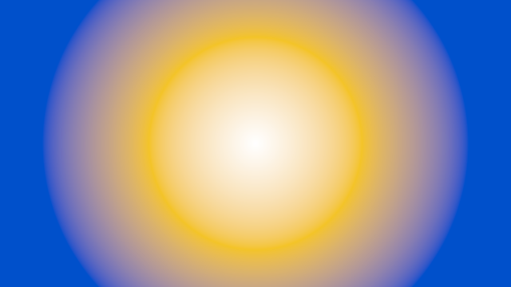

Una rampa tra due cerchi: il cerchio Start cresce e scivola dentro il cerchio End. Con i due centri
nello stesso punto è un gradiente radiale; spostando lo Start centre fuori centro si ottiene
l'effetto "luce dentro una sfera". Animando **Start centre** e **Start radius** un nucleo luminoso
attraversa la forma, come nello stile Color Fusion.

| Parametro | Controllo | Intervallo | Predefinito | Unità |
|---|---|---|---|---|
| **Start centre X**, **Start centre Y** | Punto | qualsiasi | 960, 540 | px |
| **Start radius** | Slider | da 0 a 2000 | 0 | px |
| **End centre X**, **End centre Y** | Punto | qualsiasi | 960, 540 | px |
| **End radius** | Slider | da 0 a 4000 | 800 | px |
| **Spread** | Menu | Pad · Repeat · Mirror | Pad | |
| **Paint** | Menu | Inside layer · Whole frame | Inside layer | |
| *Righe della rampa* | | vedi [La rampa](#la-rampa) | | |

Dove nessun cerchio del cono arriva (quando il cerchio Start esce dal cerchio End) il risultato è
trasparente.

**In Cavalry:** il Gradient Shader impostato su Conical. Uno shader di Cavalry riempie una forma;
qui *Paint ▸ Inside layer* fa lo stesso su qualsiasi layer. La rampa ha al massimo 5 colori.

**Esempio:** su un layer forma circolare, anima Start centre dall'alto a sinistra al centro e Start
radius da 0 a 200: un nucleo luminoso scivola dentro la sfera.

---

## Sweep gradient

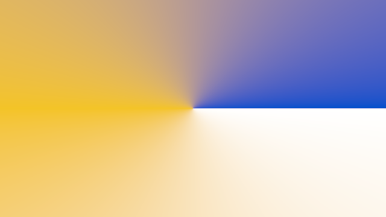

La rampa gira attorno a un centro, come un radar o una ruota dei colori.

| Parametro | Controllo | Intervallo | Predefinito | Unità |
|---|---|---|---|---|
| **Centre X**, **Centre Y** | Punto | qualsiasi | 960, 540 | px |
| **Rotation** | Manopola | qualsiasi angolo | 0 | ° |
| **Arc** | Slider | da 1 a 360 | 360 | ° |
| **Repetitions** | Numero intero | da 1 a 64 | 1 | |
| **Spread** | Menu | Pad · Repeat · Mirror | Pad | |
| **Paint** | Menu | Inside layer · Whole frame | Inside layer | |
| *Righe della rampa* | | vedi [La rampa](#la-rampa) | | |

La rampa parte da **Rotation** (0° punta a destra) e gira in senso orario per **Arc**.
**Repetitions** fa stare la rampa quel numero di volte dentro l'Arc; con **Spread** *Mirror* le
giunture non si vedono.

**In Cavalry:** il Gradient Shader impostato su Sweep. Arc e Repetitions sono già inclusi, e la
rampa ha al massimo 5 colori.

**Esempio:** anima Rotation da 0° a 360° per un radar. Per raggi senza giunture, imposta
Repetitions 6 e Spread *Mirror*.

---

## Multi-point gradient

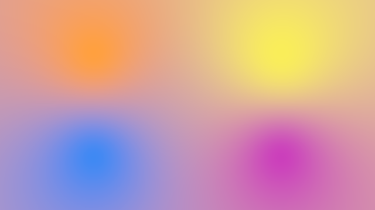

Fino a sei punti colorati, ognuno attira i colori attorno a sé.

| Parametro | Controllo | Intervallo | Predefinito | Unità |
|---|---|---|---|---|
| **Points** | Numero intero | da 2 a 6 | 4 | |
| **Power** | Slider | da 0.5 a 8 | 2 | |
| **Point 1 X** … **Point 6 Y** | Punto | qualsiasi | angoli, centro, alto | px |
| **Colour 1** … **Colour 6** | Colore | | arancio, giallo, blu, viola, bianco, nero | |
| **Influence 1** … **Influence 6** | Slider | da 0 a 400 | 100 | % |
| **Paint** | Menu | Inside layer · Whole frame | Inside layer | |

- Vengono usati solo i primi **Points** punti.
- **Power** decide quanto bruscamente il colore di un punto lascia il posto al successivo: valori
  bassi sfumano molto, valori alti creano celle attorno a ogni punto.
- **Influence** fa arrivare un punto più lontano (sopra 100) o meno lontano (sotto 100).

**In Cavalry:** il Multi-Point Gradient Shader. Qui i punti sono al massimo 6, e ogni punto è una
coppia di righe, non un oggetto a parte. Per far seguire un layer a un punto, collega la sua
posizione o usa un'espressione.

**Esempio:** anima lentamente i quattro punti attorno al fotogramma per uno sfondo a mesh gradient
in movimento.

---

## Gradient map

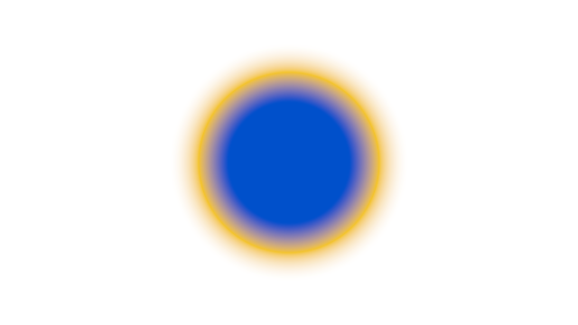

*Sopra: Falloff seguito da Gradient map sullo stesso layer.*

Legge quanto è luminoso ogni pixel e lo colora con la rampa: lo scuro con la Position 0, il chiaro
con la Position 100. Il layer mantiene la sua trasparenza.

| Parametro | Controllo | Intervallo | Predefinito | Unità |
|---|---|---|---|---|
| **Source** | Menu | Luminance · Red · Green · Blue · Alpha | Luminance | |
| **Reverse** | Casella | | No | |
| *Righe della rampa* | | vedi [La rampa](#la-rampa) | | |

Mettilo dopo qualsiasi effetto che produce grigi (Falloff, Fractal noise, una sfocatura…) per
colorarlo. Con la rampa predefinita il nero diventa bianco, il grigio medio ambra e il bianco blu.

**In Cavalry:** il Gradient Map Filter. Qui ha al massimo 5 colori, e **Source** può leggere un
canale invece della luminanza.

**Esempio:** il Fractal noise di Lumit seguito da Gradient map trasforma un rumore grigio in fumo
colorato.

---

## Voronoi

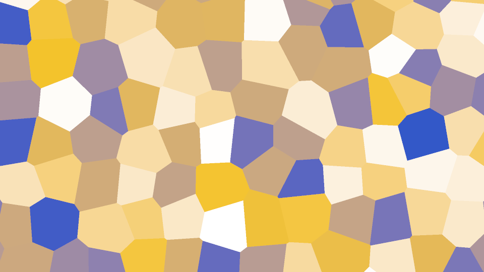

Un motivo a celle: un punto sparso in ogni cella, e ogni pixel misurato rispetto ai punti più
vicini.

| Parametro | Controllo | Intervallo | Predefinito | Unità |
|---|---|---|---|---|
| **Mode** | Menu | Cells · Distance · Edges | Cells | |
| **Cell size** | Slider | da 4 a 1000 | 160 | px |
| **Randomness** | Slider | da 0 a 100 | 100 | % |
| **Evolution** | Manopola | qualsiasi angolo | 0 | ° |
| **Offset X**, **Offset Y** | Punto | qualsiasi | 0, 0 | px |
| **Edge width** | Slider | da 0 a 100 | 4 | px |
| **Seed** | Seed | qualsiasi | | |
| **Paint** | Menu | Inside layer · Whole frame | Inside layer | |
| *Righe della rampa* | | vedi [La rampa](#la-rampa) | | |

- **Cells** colora ogni cella con un colore scelto dalla rampa; **Distance** sfuma da ogni punto
  (Position 0) verso l'esterno (Position 100); **Edges** disegna i bordi, con la Position 0 dentro
  le celle e la 100 sui bordi.
- Con **Randomness** a 0 i punti si allineano in una griglia.
- **Evolution** fa girare ogni punto su un piccolo cerchio: animala da 0 a 360 per un loop
  perfetto. **Offset** fa scorrere tutto il motivo.

**In Cavalry:** il Voronoi Shader. Cavalry ha anche una forma Voronoi, le cui celle si possono
modificare come tracciati; questo effetto produce solo pixel.

**Esempio:** Mode *Edges*, Cell size 200, con Evolution animato da 0° a 360° per tutta la durata
della composizione: una rete di celle che va in loop.

---

## Checkerboard

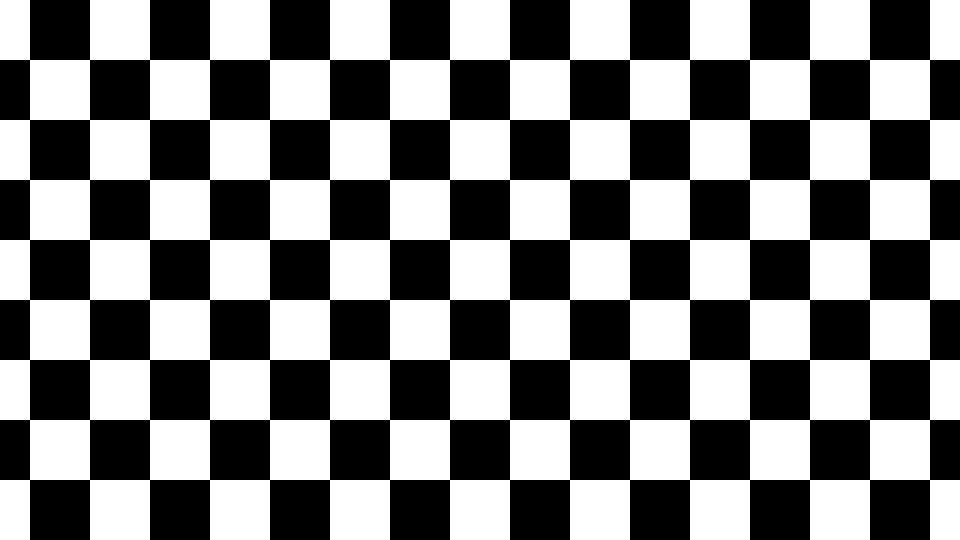

| Parametro | Controllo | Intervallo | Predefinito | Unità |
|---|---|---|---|---|
| **Cell width** | Slider | da 1 a 1000 | 120 | px |
| **Cell height** | Slider | da 1 a 1000 | 120 | px |
| **Rotation** | Manopola | qualsiasi angolo | 0 | ° |
| **Centre X**, **Centre Y** | Punto | qualsiasi | 960, 540 | px |
| **Colour 1** | Colore | | bianco | |
| **Colour 2** | Colore | | nero | |
| **Paint** | Menu | Inside layer · Whole frame | Inside layer | |

Un angolo tra quattro celle cade sul Centre. I bordi sono ammorbiditi su un pixel, così la
scacchiera non sfarfalla quando gira o si muove.

**In Cavalry:** il Checkerboard Shader. Qui le celle possono essere rettangoli, e la scacchiera
può essere ruotata.

**Esempio:** un'immagine di prova sotto Bend, Wave o Four point warp, per vedere esattamente come si
muove l'immagine.

---

## Halftone

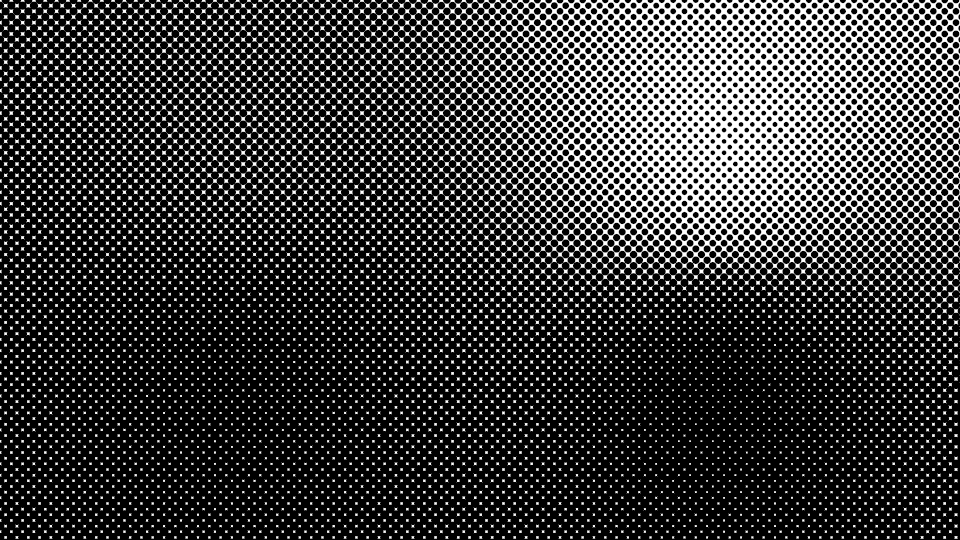

*Sopra: Multi-point gradient seguito da Halftone.*

Ridisegna l'immagine come una retinatura di stampa. Ogni cella legge l'immagine una sola volta al
centro: più è scura, più il segno è grande.

| Parametro | Controllo | Intervallo | Predefinito | Unità |
|---|---|---|---|---|
| **Shape** | Menu | Dots · Lines · Squares | Dots | |
| **Cell size** | Slider | da 2 a 200 | 16 | px |
| **Angle** | Manopola | qualsiasi angolo | 45 | ° |
| **Softness** | Slider | da 0 a 10 | 1 | px |
| **Keep colours** | Casella | | No | |
| **Ink** | Colore | | nero | |
| **Paper** | Colore | | bianco | |
| **Reverse** | Casella | | No | |

- **Keep colours** stampa ogni segno con il colore dell'immagine invece che con **Ink**.
- **Reverse** dà i segni grandi alle zone chiare.
- Il layer mantiene la sua trasparenza.

**In Cavalry:** l'Halftone Filter. Qui **Keep colours** stampa ogni segno con il colore
dell'immagine.

**Esempio:** sul girato, con Cell size 10, Angle 15° e Keep colours attivo, si ottiene un effetto
da stampa a fumetti.

---

## Dithering

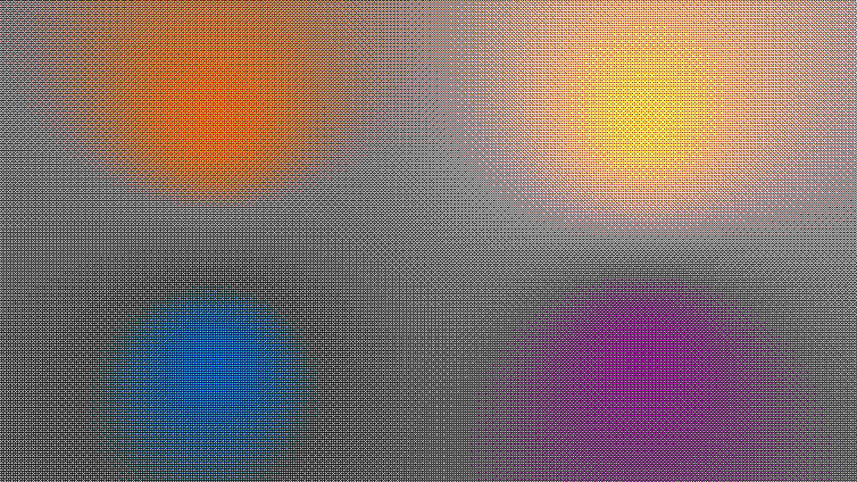

*Sopra: Multi-point gradient seguito da Dithering, Colour, 2 livelli.*

Riduce l'immagine a pochi livelli, e i passaggi tra un livello e l'altro diventano una trama fine.

| Parametro | Controllo | Intervallo | Predefinito | Unità |
|---|---|---|---|---|
| **Method** | Menu | Ordered · Noise | Ordered | |
| **Levels** | Numero intero | da 2 a 16 | 2 | |
| **Pixel size** | Slider | da 1 a 32 | 2 | px |
| **Colours** | Menu | Colour · Monochrome | Colour | |
| **Dark** | Colore | | quasi nero | |
| **Light** | Colore | | bianco caldo | |
| **Seed** | Seed | qualsiasi | | |

- **Ordered** usa una matrice di Bayer 8 × 8, **Noise** una trama casuale fissa (se ne sceglie
  un'altra con **Seed**).
- **Levels** vale per ogni canale in *Colour*; in *Monochrome* la luminosità viene retinata tra
  **Dark** e **Light**, adatto a un look da schermo retrò.
- **Pixel size** ingrandisce i pixel della retinatura.

**In Cavalry:** il Dithering Filter. Le trame sono una Bayer 8 × 8 o di rumore, a colori o con due
toni a scelta.

**Esempio:** Colours *Monochrome*, Levels 2 e Pixel size 3, con Dark e Light su due verdi: lo
schermo di una vecchia console portatile.

---

## Inner shadow

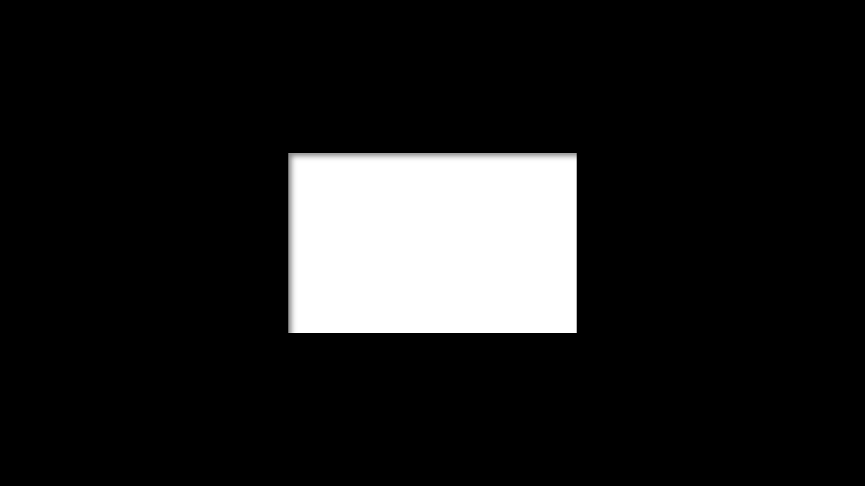

*Sopra: un solid 640 × 400 con Inner shadow ai valori predefiniti.*

Un'ombra morbida proiettata dentro i bordi del layer.

| Parametro | Controllo | Intervallo | Predefinito | Unità |
|---|---|---|---|---|
| **Colour** | Colore | | nero, opaco al 75 % | |
| **Angle** | Manopola | qualsiasi angolo | 45 | ° |
| **Distance** | Slider | da 0 a 200 | 12 | px |
| **Size** | Slider | da 0 a 200 | 16 | px |
| **Choke** | Slider | da 0 a 100 | 0 | % |

- **Angle** è la direzione in cui cade l'ombra (0° verso destra, 90° verso il basso): con il
  valore predefinito l'ombra sta sui bordi in alto e a sinistra.
- **Size** è la sfocatura; **Choke** rende l'ombra più densa prima che sfumi.
- Oltre i bordi del layer conta come esterno: su un layer di forme o di testo l'ombra segue la
  forma.
- Viene disegnata in tre passaggi, le due sfocature a metà risoluzione, quindi resta leggera anche
  su schede grafiche modeste.

**In Cavalry:** l'Inner Shadow Filter. L'ombra resta dentro l'immagine del layer.

**Esempio:** su un layer di testo, Angle 90°, Distance 4 e Size 6: le lettere sembrano impresse
nello sfondo.

---

## Erosion

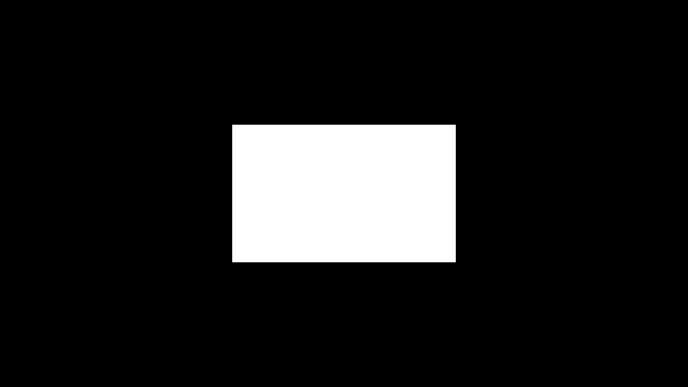

*Sopra: Erosion a 8 px su un solid 640 × 400, che diventa 624 × 384.*

Restringe la forma del layer (choke) o la allarga (spread).

| Parametro | Controllo | Intervallo | Predefinito | Unità |
|---|---|---|---|---|
| **Amount** | Slider | da −64 a 64 | 8 | px |

- Sopra 0 ogni pixel prende il pixel più trasparente entro Amount: la forma si restringe. Sotto 0
  prende quello più opaco: la forma si allarga, portando fuori i colori del bordo.
- Lavora prima in orizzontale e poi in verticale, quindi gli angoli restano squadrati.
- Oltre i bordi del layer conta come trasparente. Uno spread non può crescere oltre l'immagine del
  layer: se serve, metti prima il layer in una precomp più grande.

**In Cavalry:** l'Erosion Filter. Qui arriva al massimo a 64 px in entrambe le direzioni, e uno
spread non può uscire dall'immagine del layer.

**Esempio:** su un logo, anima Amount da 0 a 40 e la forma viene erosa fino a sparire.

---

## Light sweep

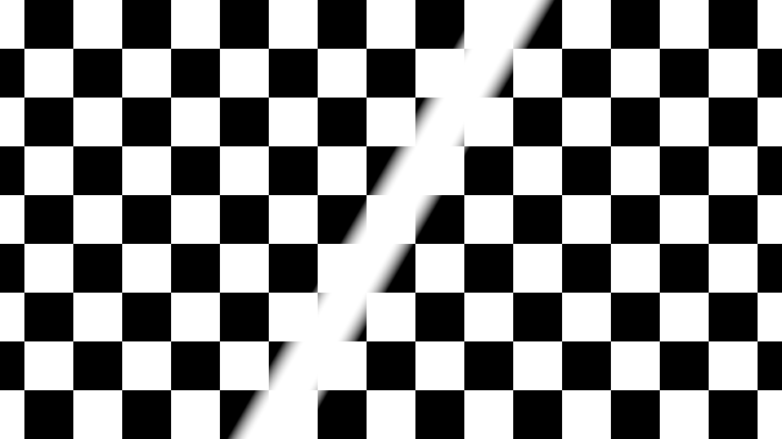

*Sopra: Checkerboard seguita da Light sweep.*

Una fascia di luce morbida che attraversa il layer. Anima **Centre** per farla scorrere.

| Parametro | Controllo | Intervallo | Predefinito | Unità |
|---|---|---|---|---|
| **Centre X**, **Centre Y** | Punto | qualsiasi | 960, 540 | px |
| **Angle** | Manopola | qualsiasi angolo | 30 | ° |
| **Width** | Slider | da 0 a 2000 | 160 | px |
| **Softness** | Slider | da 0 a 100 | 60 | % |
| **Colour** | Colore | | bianco | |
| **Intensity** | Slider | da 0 a 400 | 100 | % |
| **Mode** | Menu | Add · Screen | Add | |

- **Angle** è la direzione in cui la fascia si sposta quando muovi Centre lungo di essa; la fascia
  è disposta di traverso.
- **Softness** è la parte della Width che sfuma ai lati.
- *Add* può superare il bianco, per un riflesso acceso; *Screen* non lo supera mai.
- La luce cade solo dove il layer disegna.

**In Cavalry:** il Light Sweep Filter. La luce cade solo dove il layer disegna.

**Esempio:** su un logo, anima Centre X da −200 a 2100 in un secondo per un riflesso che lo
attraversa.

---

## Lighting

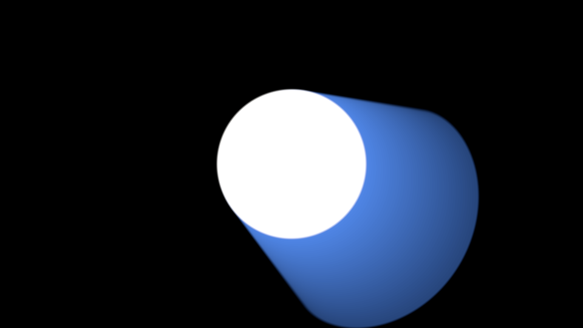

*Sopra: un disco con alpha disegnato da Falloff, poi Lighting con una luce puntiforme in alto a
sinistra. L'ombra qui è blu solo perché lo sfondo della composizione è nero.*

Ombre lunghe e una luce, come il Lighting Filter di Cavalry. Ogni pixel trasparente guarda verso la
luce per vedere se qualcosa di opaco la copre.

| Parametro | Controllo | Intervallo | Predefinito | Unità |
|---|---|---|---|---|
| **Light** | Menu | Point · Directional | Point | |
| **Light position X**, **Light position Y** | Punto | qualsiasi | 400, 200 | px |
| **Angle** | Manopola | qualsiasi angolo | 45 | ° |
| **Length** | Slider | da 0 a 2000 | 400 | px |
| **Fade** | Slider | da 0 a 100 | 50 | % |
| **Shadow colour** | Colore | | nero, opaco al 60 % | |
| **Light colour** | Colore | | bianco caldo | |
| **Light intensity** | Slider | da 0 a 400 | 50 | % |
| **Light radius** | Slider | da 0 a 4000 | 1200 | px |

- **Point** proietta le ombre lontano da **Light position**; **Directional** le proietta tutte
  lungo **Angle**, come la luce del sole.
- **Length** è quanto arriva lontano un'ombra, **Fade** quanto si schiarisce lungo il percorso.
- I pixel del layer vengono schiariti da **Light colour** × **Light intensity**, sempre meno con
  la distanza fino a **Light radius** (solo con Point).
- Le ombre possono cadere solo dentro l'immagine del layer: usalo su un layer grande come la
  composizione, per esempio una precomp della grafica.

**In Cavalry:** il Lighting Filter. Le ombre possono cadere solo dentro l'immagine del layer, e
gli ostacoli si cercano con 48 campioni.

**Esempio:** fai una precomp di alcune forme piatte e aggiungi Lighting alla precomp, con Light
*Point* in alto a sinistra. Le forme proiettano ombre lunghe verso il basso a destra.

---

## Stripes

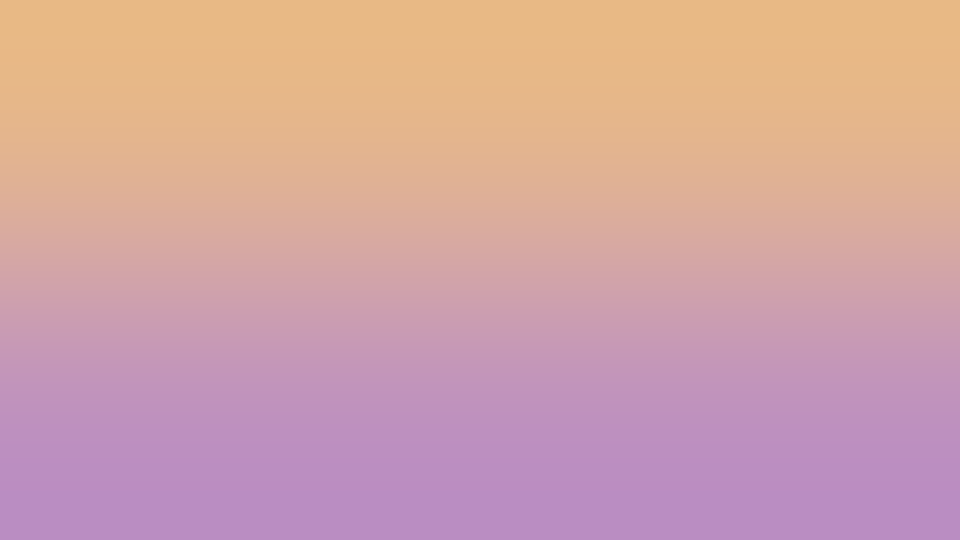

*Sopra: Multi-point gradient seguito da Stripes ai valori predefiniti.*

Legge una fascia di pixel che passa per **Centre** e la ripete lungo **Angle**. Con una Width di
1 px ogni pixel della linea viene tirato fuori in una striscia.

| Parametro | Controllo | Intervallo | Predefinito | Unità |
|---|---|---|---|---|
| **Centre X**, **Centre Y** | Punto | qualsiasi | 960, 540 | px |
| **Angle** | Manopola | qualsiasi angolo | 0 | ° |
| **Width** | Slider | da 1 a 1000 | 1 | px |
| **Side** | Menu | Both sides · Front · Back | Both sides | |

- **Angle** è la direzione delle strisce (0° vanno da sinistra a destra).
- **Width** è la fascia ripetuta: fasce più larghe creano fette dell'immagine che si ripetono.
- **Side** lo limita a un lato della linea: *Front* è il lato verso cui punta Angle.

**In Cavalry:** lo Stripes Filter. **Side** lo limita a un lato della linea.

**Esempio:** sul girato, con Width 1 e Side *Front*, anima Centre Y: la riga di pixel che viene
stirata scende lungo l'immagine.

---

## Scrape

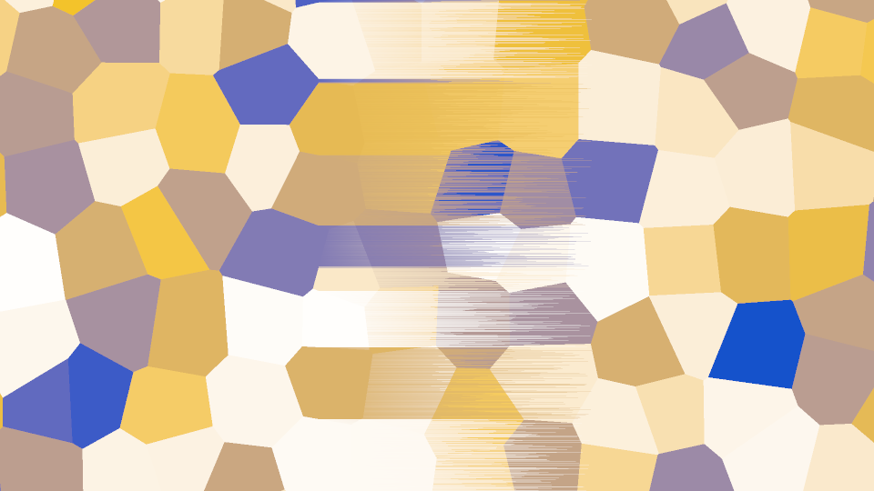

*Sopra: Voronoi seguito da Scrape, con Centre spostato a sinistra e Roughness a 60.*

Trascina i pixel di una linea che passa per **Centre** lungo **Angle**, sfumandoli.

| Parametro | Controllo | Intervallo | Predefinito | Unità |
|---|---|---|---|---|
| **Centre X**, **Centre Y** | Punto | qualsiasi | 960, 540 | px |
| **Angle** | Manopola | qualsiasi angolo | 0 | ° |
| **Length** | Slider | da 0 a 4000 | 600 | px |
| **Roughness** | Slider | da 0 a 100 | 30 | % |
| **Fade** | Slider | da 0 a 100 | 50 | % |
| **Seed** | Seed | qualsiasi | | |

- Viene trascinato solo il lato verso cui punta **Angle**; il resto non cambia.
- **Roughness** dà a ogni riga di pixel una lunghezza diversa, come colore tirato da un bordo
  ruvido; **Seed** sceglie un'altra combinazione.
- **Fade** fa rientrare la scia nell'immagine verso la sua fine.

**In Cavalry:** lo Scrape Filter. Viene raschiato solo il lato verso cui punta Angle, e
**Roughness** dà a ogni riga la sua lunghezza.

**Esempio:** su un titolo, anima Centre X da sinistra a destra: le lettere si sbavano dietro di lui
come vernice fresca.

---

## Bilateral blur

| Prima | Dopo |
|---|---|
| 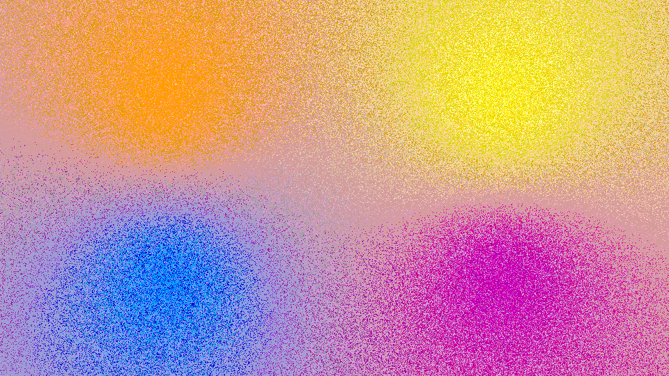 | 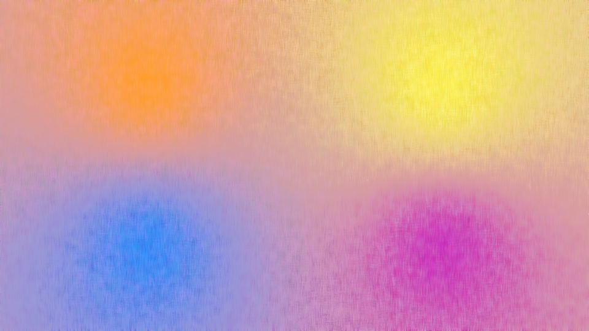 |

*Sopra: un gradiente retinato e rumoroso, poi Bilateral blur a 20 px, Tolerance 45.*

Ammorbidisce le zone di colore simile e mantiene netti i bordi tra una zona e l'altra.

| Parametro | Controllo | Intervallo | Predefinito | Unità |
|---|---|---|---|---|
| **Radius** | Slider | da 0 a 100 | 8 | px |
| **Tolerance** | Slider | da 1 a 100 | 20 | % |

- Un pixel vicino conta tanto meno quanto più il suo colore è diverso; **Tolerance** è quanta
  differenza conta ancora come "simile". Basso conserva più dettaglio, alto sfoca di più.
- Viene calcolato prima in orizzontale e poi in verticale, con 25 campioni per direzione.

**In Cavalry:** il Bilateral Blur Filter. Qui si calcola in orizzontale e poi in verticale, il che
si avvicina al filtro completo ma non è identico.

**Esempio:** ripulisci un gradiente rumoroso o retinato prima di Halftone, oppure ammorbidisci la
pelle tenendo netti i contorni.

---

## Bend

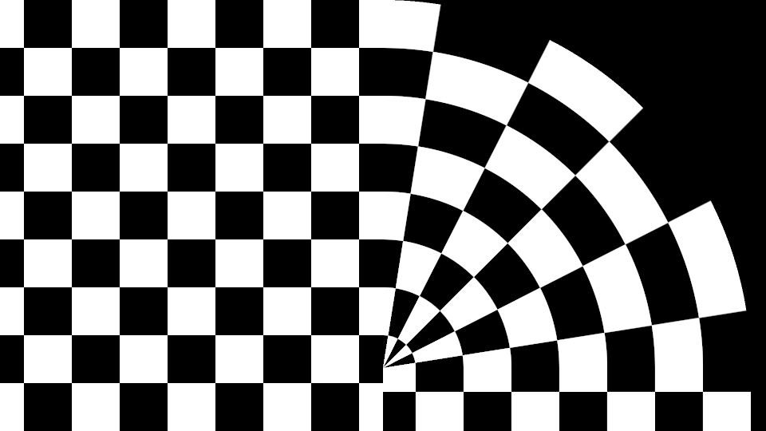

*Sopra: Checkerboard seguita da Bend ai valori predefiniti.*

Arrotola l'immagine attorno a un cerchio, come il Bend Deformer di Cavalry fa con una forma, ma sui
pixel.

| Parametro | Controllo | Intervallo | Predefinito | Unità |
|---|---|---|---|---|
| **Centre X**, **Centre Y** | Punto | qualsiasi | 960, 540 | px |
| **Angle** | Manopola | qualsiasi angolo | 0 | ° |
| **Bend** | Slider | da −360 a 360 | 90 | ° |
| **Length** | Slider | da 1 a 4000 | 600 | px |

- Da **Centre**, lungo **Angle**, un tratto lungo **Length** viene piegato di **Bend** gradi. Ciò
  che sta oltre prosegue dritto nella nuova direzione; ciò che sta dietro Centre non cambia.
- Un Bend negativo piega dall'altra parte. Dove non arriva niente il risultato è trasparente.

**In Cavalry:** il Bend Deformer. Cavalry piega i punti di una forma, quindi il contorno resta
netto. Qui si spostano i pixel: dopo, un layer forma non viene ridisegnato netto.

**Esempio:** su una lunga striscia di testo, Bend 180° e Length 400: la fine della striscia si
arrotola su se stessa.

---

## Wave

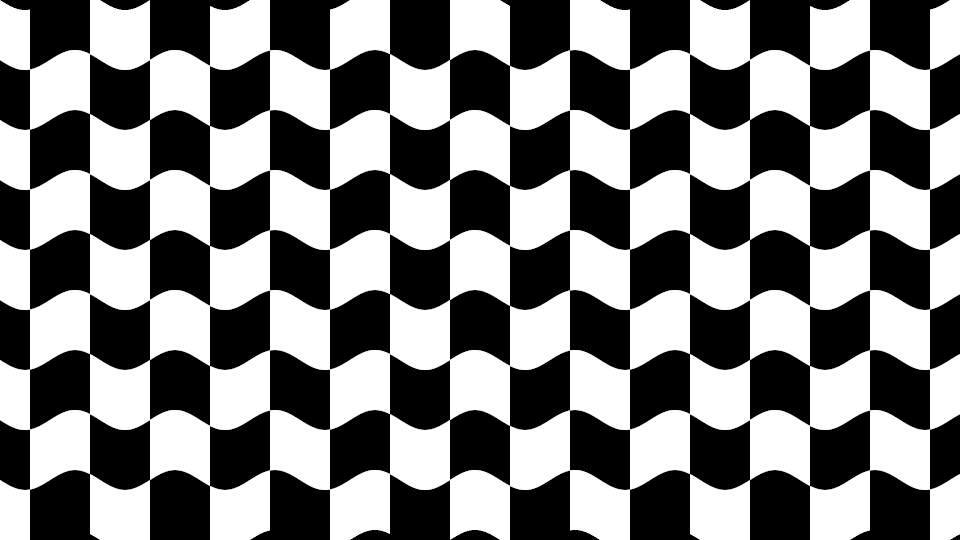

*Sopra: Checkerboard seguita da Wave ai valori predefiniti.*

Un'onda attraversa l'immagine e la spinge di lato, come il Wave di Cavalry su un tracciato.

| Parametro | Controllo | Intervallo | Predefinito | Unità |
|---|---|---|---|---|
| **Shape** | Menu | Sine · Triangle · Square · Sawtooth | Sine | |
| **Amplitude** | Slider | da 0 a 500 | 20 | px |
| **Wavelength** | Slider | da 2 a 4000 | 200 | px |
| **Angle** | Manopola | qualsiasi angolo | 0 | ° |
| **Phase** | Manopola | qualsiasi angolo | 0 | ° |
| **Speed** | Slider | da −10 a 10 | 1 | |

- **Angle** è la direzione in cui corre l'onda; l'immagine viene spinta di traverso.
- **Speed** sono le onde al secondo, quindi si muove da sola. Per un loop perfetto metti Speed a
  0 e anima **Phase** da 0° a 360°.

**In Cavalry:** il Wave Deformer, che sposta i punti di un tracciato. Qui si spostano i pixel, e
**Speed** lo fa muovere senza keyframe.

**Esempio:** su una bandiera o un layer a strisce, Amplitude 30, Wavelength 400 e Speed 0.5.

---

## Four point warp

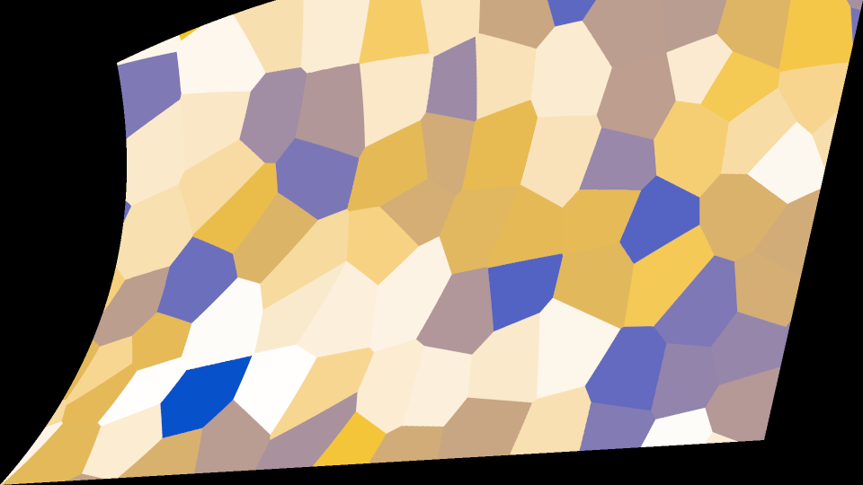

*Sopra: Voronoi seguito da Four point warp, con due angoli spostati e due bordi curvati.*

Fissa i quattro angoli del layer su quattro punti e curva ogni bordo verso l'interno o l'esterno.

| Parametro | Controllo | Intervallo | Predefinito | Unità |
|---|---|---|---|---|
| **Top left X/Y** | Punto | qualsiasi | 0, 0 | px |
| **Top right X/Y** | Punto | qualsiasi | 1920, 0 | px |
| **Bottom right X/Y** | Punto | qualsiasi | 1920, 1080 | px |
| **Bottom left X/Y** | Punto | qualsiasi | 0, 1080 | px |
| **Curve top**, **Curve right**, **Curve bottom**, **Curve left** | Slider | da −1000 a 1000 | 0 | px |

- I valori predefiniti corrispondono a un layer 1920 × 1080, quindi all'inizio non cambia nulla:
  trascina i punti nel Viewer.
- **Curve** curva un bordo verso l'esterno (positivo) o l'interno (negativo) al suo centro, al
  posto delle maniglie bézier di Cavalry.
- Ogni pixel viene ricondotto all'immagine di partenza, quindi il risultato resta nitido. Fuori
  dalla forma deformata è trasparente.

**In Cavalry:** Four Point Warp. Qui ogni bordo si curva con una sola Curve invece di due maniglie
bézier, e si spostano i pixel.

**Esempio:** inserisci una registrazione dello schermo nello schermo di un mock-up di telefono,
trascinando i quattro angoli sugli angoli dello schermo.

---

## Type fill

*Sopra: due Type fill sullo stesso Region layer, l'esempio Flood (una G gigante, Cut words attivo).*

Costruito nell'engine (modifica 10), sotto **Siceliot FX**. Dispone le **Words**, scritte tra
barre, in righe dall'alto in basso. Ogni riga è divisa in colonne per tutta la larghezza, una
parola ciascuna, larghe quanto le parole lo sono naturalmente. Lungo ogni riga una colonna tiene
solo i tratti lasciati liberi dal **Region layer**. La parola della colonna è allungata in
larghezza e altezza dal primo all'ultimo di questi tratti, se sono larghi almeno **Min width**, e
ogni tratto ne mostra la sua fetta: una forma che taglia una colonna in due taglia la sua parola,
"t" da una parte e "he" dall'altra, e non la mostra mai due volte. L'aspetto (font, stile,
colore) viene da un **Text layer**, che può essere nascosto.

| Parametro | Controllo | Intervallo | Predefinito | Unità |
|---|---|---|---|---|
| **Text layer** | Livello | qualsiasi | nessuno | |
| **Words** | Testo | parole tra `\|` | `Flood\|the\|Grid` | |
| **Region layer** | Livello | qualsiasi | nessuno (tutto il quadro) | |
| **Region placement** | Menu | As placed in comp, Stretch to fit, Centre | As placed in comp | |
| **Region from** | Menu | Alpha, Luminance | Alpha | |
| **Invert region** | Casella | | spenta | |
| **Cut words** | Casella | | spenta | |
| **Threshold** | Cursore | da 0 a 100 | 50 | % |
| **Rows** | Cursore | da 1 a 200 | 24 | |
| **Row gap** | Cursore | da 0 a 200 | 6 | px |
| **Word gap** | Cursore | da 0 a 200 | 8 | px |
| **Min width** | Cursore | da 0 a 1000 | 24 | px |
| **Order** | Menu | In turn, Shift per row, Random | In turn | |
| **Seed** | Seed | qualsiasi | casuale | |

- Un punto è nella regione dove il Region layer è opaco (Alpha) o luminoso (Luminance) almeno
  quanto **Threshold**. **Invert region** riempie dove non lo è.
- **Word gap** è lo spazio tra le parole e ai bordi della regione.
- **Cut words**: ogni parola resta intera, larga quanto la sua colonna, e la regione la taglia
  pixel per pixel invece di allungarla nello spazio che ha. Due Type fill sui due lati di una forma
  si dividono così ogni parola: "th" bianco dentro, "e" nero fuori. Word gap allora è solo lo
  spazio tra le parole.
- In ogni caso la regione taglia le parole pixel per pixel, così una riga alta non fa mai uscire una
  parola da un bordo curvo: niente parole bianche sul bianco né nere sul nero.
- **Order**: lo stesso ordine in ogni riga, spostato di una parola a riga, o mescolato da **Seed**.
- Due Type fill sullo stesso Region layer, uno invertito e nell'altro colore, riempiono entrambi
  i lati di una forma. Metti le forme in una precomp per combinarle con i metodi di fusione, e
  animale: le parole invadono lo spazio che lasciano.
- Un font condensato (per esempio Impact) tiene leggibili le parole quando sono strette.

**In Cavalry:** non c'è un nodo unico. La scena *Submesh Boolean* di Tim Siegert ottiene l'effetto
con testo, un Duplicator e operazioni booleane. Qui è un solo effetto, e la regione può essere
l'alfa o la luminosità di qualsiasi layer.

**Esempio:** l'esempio [Flood](esempi.md#flood): due Type fill su una precomp di forme animate,
parole nere fuori e bianche dentro.

---

## Siceliot Nodes

I cinque nodi sono driver: producono un numero, non un'immagine (vedi
[Siceliot FX e Siceliot Nodes](#siceliot-fx-e-siceliot-nodes)). In ogni nodo **Minimum** e
**Maximum** sono slider da −100 a 100, e si può scrivere qualsiasi valore. Le righe che la modalità
scelta non usa diventano grigie.

**Come si usano.** Apri il **Node graph** del layer, premi `Ctrl+Space` (o clic destro sulla tela)
e scegli il driver sotto l'intestazione **Siceliot Nodes**. Trascina un filo dalla sua presa **Value**
alla presa di un parametro qualsiasi, di qualsiasi effetto, Siceliot o no. Il parametro segue il
driver invece dei suoi keyframe.

**Con Clone to points** (il Duplicator di Lumit): metti il driver sul layer che viene clonato. Ogni
copia riceve il suo valore, come un Random o uno Stagger di Cavalry dà a ogni copia di un
Duplicator il suo. Il layer viene renderizzato una volta per copia (al massimo 32 diverse, il
limite di Clone to points in Lumit). Fuori da Clone to points un layer è la prima copia di una, e i
driver funzionano comunque come semplici valori nel tempo.

**Ruotare, scalare e dissolvere ogni copia** (come Shape Rotation, Shape Scale e Opacity su un
Duplicator di Cavalry): metti il driver sul layer **Points**, quello che ha Clone to points, e
collega il suo **Value** a **Rotation**, **Scale** o **Opacity** di Clone to points. Ogni timbro
prende il suo valore, ruotato e scalato per intero, senza ritagli. È questo il modo giusto di
ruotare le copie: un effetto Transform sul layer clonato le ritaglia, perché l'immagine di un layer
è grande solo quanto il suo disegno.

| Senza driver | Stagger da 0 a 90 su Rotation |
|---|---|
| 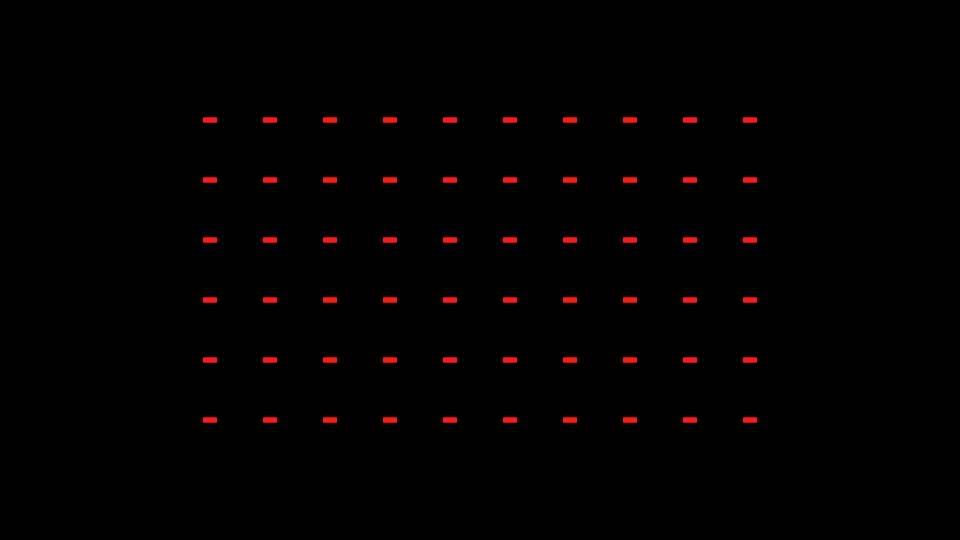 | 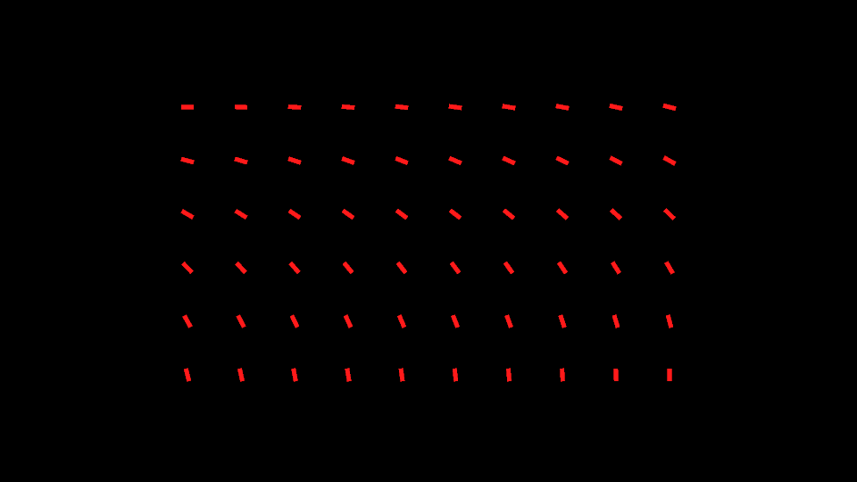 |

Rotation si somma alla rotazione di ogni punto, in gradi; Scale e Opacity sono in percentuale,
come le righe.

Tutti e cinque danno sempre lo stesso valore per lo stesso frame, su qualsiasi computer.

### Stagger

Un valore che va da **Minimum** sulla prima copia a **Maximum** sull'ultima.

| Parametro | Controllo | Intervallo | Predefinito |
|---|---|---|---|
| **Minimum** | Slider | da −100 a 100, qualsiasi scrivendolo | 0 |
| **Maximum** | Slider | da −100 a 100, qualsiasi scrivendolo | 100 |
| **Curve** | Curva | | diagonale dritta |
| **Offset** | Slider | da −100 a 100 % | 0 |
| **Loop** | Casella | | No |
| **Reverse** | Casella | | No |

- **Curve** distribuisce i valori tra la prima e l'ultima copia: una curva a S li addensa ai due
  estremi.
- **Offset** sposta la sequenza lungo le copie, come quota del totale. Animalo con **Loop** attivo
  per far passare un'onda attraverso le copie.
- **Reverse** dà Maximum alla prima copia.

**In Cavalry:** il Behaviour Stagger, con il suo grafico come **Curve**.

**Esempio:** Stagger da 0 a 90 su Rotation di Clone to points (le immagini sopra). Anima Offset da
0 a 100 % con Loop attivo, e una rotazione percorre le copie.

### Random

Un valore casuale per ogni copia, uguale in ogni frame.

| Parametro | Controllo | Intervallo | Predefinito |
|---|---|---|---|
| **Minimum** | Slider | da −100 a 100, qualsiasi scrivendolo | 0 |
| **Maximum** | Slider | da −100 a 100, qualsiasi scrivendolo | 100 |
| **Bias** | Slider | da −100 a 100 | 0 |
| **Rate** | Slider | da 0 a 30 | 0 |
| **Seed** | Seed | qualsiasi | |

- **Bias** sposta i valori verso Minimum (sotto 0) o Maximum (sopra 0).
- **Rate** è il numero di nuovi valori al secondo; a 0 ogni copia tiene il suo valore per sempre.
- **Seed** sceglie un'altra serie di valori.

**In Cavalry:** il Behaviour Random. Qui **Bias** sbilancia i valori, e **Rate** ne genera di
nuovi nel tempo senza keyframe.

**Esempio:** Random da 40 a 160 su Scale di Clone to points: ogni copia ha la sua dimensione. Con
Rate 4 cambiano dimensione quattro volte al secondo.

### Oscillator

Un valore che oscilla tra **Minimum** e **Maximum** seguendo un'onda.

| Parametro | Controllo | Intervallo | Predefinito |
|---|---|---|---|
| **Shape** | Menu | Sine · Triangle · Square · Sawtooth | Sine |
| **Minimum** | Slider | da −100 a 100, qualsiasi scrivendolo | 0 |
| **Maximum** | Slider | da −100 a 100, qualsiasi scrivendolo | 100 |
| **Frequency** | Slider | da 0 a 20 | 1 |
| **Phase** | Manopola | qualsiasi angolo | 0° |
| **Phase per copy** | Manopola | qualsiasi angolo | 0° |
| **Phase from** | Menu | Copy · Position | Copy |
| **Wave angle** | Manopola | qualsiasi angolo | 0° |
| **Wavelength** | Slider | da 10 a 4000 | 400 px |

- **Frequency** sono le onde al secondo. Per un loop perfetto mettila a 0 e anima **Phase** da 0°
  a 360°.
- **Phase from = Copy**: **Phase per copy** mette ogni copia tanto più avanti sull'onda rispetto
  alla precedente, così le copie si muovono a increspatura nell'ordine in cui sono numerate (in
  una Grid: riga per riga).
- **Phase from = Position**: il punto dell'onda di ogni copia dipende da **dove si trova**. L'onda
  attraversa i punti come una texture, viaggiando lungo **Wave angle** (0° da sinistra a destra,
  90° dall'alto in basso), con una cresta ogni **Wavelength** pixel. Funziona con qualsiasi
  disposizione di punti: Grid, Scatter o Particulate. La posizione è nota solo quando il driver è
  collegato a Scale, Rotation o Opacity di Clone to points; altrove vale come l'angolo in alto a
  sinistra della composizione.
- Una sinusoide parte a metà tra Minimum e Maximum, in salita.

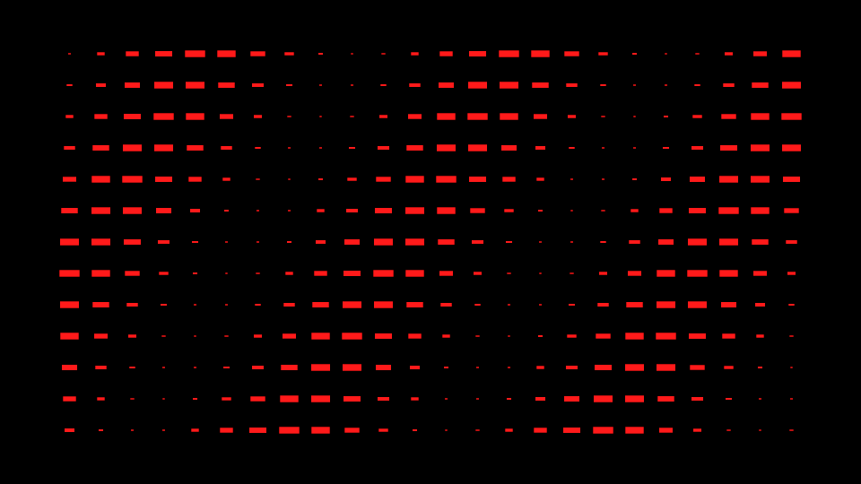

*Sopra: una Grid 24 × 13 di barrette, un Oscillator con Phase from = Position (Wave angle 30°,
Wavelength 600 px, Minimum 100, Maximum 900) collegato a Scale di Clone to points. Il frame 12, mezzo secondo dopo: [copies-wave-12.png](../images/copies-wave-12.png).*

**In Cavalry:** il Behaviour Oscillator. Qui produce solo valori; per far ondulare l'immagine
stessa usa l'effetto [Wave](#wave). **Phase from = Position** è un'aggiunta di SICELIOT:
un'onda che attraversa i punti nello spazio.

**Esempio:** l'immagine sopra. Con Phase from *Copy* e Phase per copy 15°, le copie pulsano una
dopo l'altra nel loro ordine.

### Value noise

Un valore che vaga in modo morbido, come il behaviour Noise di Cavalry. (In Lumit **Noise** è già
un effetto di grana, da qui il nome diverso.)

| Parametro | Controllo | Intervallo | Predefinito |
|---|---|---|---|
| **Minimum** | Slider | da −100 a 100, qualsiasi scrivendolo | 0 |
| **Maximum** | Slider | da −100 a 100, qualsiasi scrivendolo | 100 |
| **Frequency** | Slider | da 0 a 20 | 1 |
| **Detail** | Numero intero | da 1 a 4 | 1 |
| **Vary by** | Menu | Nothing · Copy · Position | Copy |
| **Noise scale** | Slider | da 10 a 4000 | 300 px |
| **Seed** | Seed | qualsiasi | |

- **Frequency** è quanto velocemente vaga. **Detail** aggiunge oscillazioni più fini, ognuna forte
  la metà della precedente.
- Le righe che la modalità scelta non usa diventano grigie: Phase per copy con Position, Wave
  angle e Wavelength con Copy (Oscillator), Noise scale se Vary by non è Position (Value noise).
- **Vary by**: *Nothing*, tutte le copie si muovono insieme; *Copy*, ogni copia vaga per conto
  suo; *Position*, le copie leggono un campo di rumore steso sopra i punti, quindi le vicine si
  muovono in modo simile e il disegno scorre nel tempo. **Noise scale** è la grandezza delle
  macchie del campo. Come per Oscillator, la posizione è nota quando il driver è collegato alle
  righe di Clone to points.

**In Cavalry:** il Behaviour Noise. Qui ha un altro nome perché **Noise** di Lumit è un effetto di
grana. *Vary by ▸ Position* stende un campo di rumore sui punti.

**Esempio:** Vary by *Position*, Noise scale 200 e da Minimum −20 a Maximum 20 su Rotation di Clone
to points: le copie ondeggiano insieme, come l'erba al vento.

### Ring wave

Anelli che si allargano uno dopo l'altro da punti del fotogramma, come sassi gettati nell'acqua
(modifica all'engine 7). È il **Ripple** di Lumit come valore invece che come distorsione, da qui
il nome diverso. Ogni punto legge quanto sono forti gli anelli su di lui: mettilo sul layer
**Points** e collegalo alle righe di Clone to points o di Label points.

| Parametro | Controllo | Intervallo | Predefinito |
|---|---|---|---|
| **Minimum** | Slider | da −100 a 100, qualsiasi digitando | 0 |
| **Maximum** | Slider | da −100 a 100, qualsiasi digitando | 100 |
| **Interval** | Slider | da 0,05 a 5 s | 0,5 |
| **Speed** | Slider | da 10 a 2000 px al secondo | 300 |
| **Speed variance** | Slider | da 0 a 500 px al secondo | 10 |
| **Thickness min** | Slider | da 1 a 1000 px | 60 |
| **Thickness max** | Slider | da 1 a 1000 px | 120 |
| **Origin** | Menu | Anywhere · Edges · Centre · Away from points | Anywhere |
| **Clearance** | Slider | da 0 a 400 px | 20 |
| **Add up** | Casella | attivo o no | no |
| **Grow min** | Slider | da 0 a 200 % | 20 |
| **Grow max** | Slider | da 0 a 200 % | 50 |
| **Spin** | Slider | da 0 a 200 % | 100 |
| **Seed** | Seed | qualsiasi | |

- Ogni **Interval** secondi nasce un nuovo anello, in un punto a caso del fotogramma (*Anywhere*),
  sul suo bordo (*Edges*), sempre al centro (*Centre*) oppure in un punto a caso distante almeno
  **Clearance** da tutti i punti a cui è collegato (*Away from points*: un anello non nasce mai
  dentro la forma riempita dai punti, come nello sketch Processing). Si allarga a **Speed**, ogni
  anello fino a **Speed variance** più veloce o più lento. **Seed** decide dove e quanto veloce.
  Clearance è grigio con le altre origini.
- **Thickness min/max**: a che distanza dalla sua linea centrale un anello sfuma a zero; ogni
  anello sta da qualche parte tra i due.
- **Add up**: se spento, gli anelli che si sovrappongono si sommano fino a Maximum; se acceso,
  continuano a sommarsi oltre, come quelli dello sketch.
- Ha quattro prese di uscita:
  - **Value**: Minimum dove non c'è nessun anello, Maximum sulla linea centrale di un anello,
    in modo continuo nel mezzo.
  - **Rotation**: una rotazione in gradi che l'anello dà ai punti che attraversa, più forte al
    centro, che segue la direzione in cui l'anello viaggia e gira lentamente. **Spin** la scala.
  - **Passes**: quanti anelli hanno attraversato il punto finora. Sale di uno quando il centro
    di ogni anello raggiunge il punto, e non torna mai indietro.
  - **Grow**: di quanto gli anelli ingrandiscono il punto, in percentuale. Ogni anello ha la sua
    quantità, tra **Grow min** e **Grow max**, piena sulla linea centrale; gli anelli sovrapposti
    si sommano. Collegalo, più 100 attraverso un **Math** (Add), a **Label scale** di Label points.
- Come gli altri driver non ha memoria: ogni fotogramma si calcola solo dal tempo, quindi scorrere
  la timeline, renderizzare fuori ordine e renderizzare di nuovo danno sempre la stessa immagine.

**In Cavalry:** nessuno. La cosa più vicina è un Falloff Circle con il raggio animato su un
Behaviour, un anello alla volta. Il **Ripple** di Lumit invece deforma i pixel.

**Esempio:** l'esempio [Sketch](esempi.md#sketch). Value del Ring wave va su Change di Label points,
Passes su Text step e Grow (più 100) su Label scale.

## Effetti di Lumit estesi da SICELIOT

Due effetti di punti di Lumit (*Effect ▸ Generate*) ricevono nuove righe dalle modifiche
all'engine. Restano sotto l'intestazione di Lumit.

### Clone to points

Timbra un layer su ogni punto, come il Duplicator di Cavalry. SICELIOT aggiunge i valori per copia
descritti in [Siceliot Nodes](#siceliot-nodes):

- un nodo collegato a **Scale**, **Rotation** o **Opacity** di Clone to points dà a ogni timbro il
  suo valore;
- un nodo sul layer clonato fa renderizzare quel layer una volta per copia.

**In Cavalry:** il Duplicator, con Shape Rotation, Shape Scale e Opacity pilotati da Behaviour. Un
layer che cambia per copia viene renderizzato al massimo in 32 versioni diverse, che è il limite di
Lumit.

### Label points

Scrive un'etichetta su ogni punto, con l'aspetto di un layer di testo. SICELIOT aggiunge testo
casuale, etichette che reagiscono a un nodo, colori continui, e una dimensione e una rotazione per
ogni etichetta.

**Come si imposta**

1. Crea un **layer di testo** con il font, la dimensione e il colore che vuoi, e nascondilo: serve
   solo a prestare il suo aspetto.
2. Sul layer **Points**, dopo **Grid** (o qualsiasi altro generatore di punti), aggiungi
   *Effect ▸ Generate ▸ **Label points***. Si collega da solo al generatore sopra. Disattiva
   **Clone to points**, oppure tienili entrambi per avere testo accanto alle forme.
3. Imposta **Text layer** sul tuo layer di testo, **Anchor** su Centre e **Offset x / y** a 0,
   così ogni etichetta sta sul suo punto.
4. Scrivi un template in **Text**. I segnaposto casuali si mescolano con testo normale e con quelli
   di Lumit, per esempio `ID-{index}-{chars:4}`:

| Segnaposto | Diventa | Esempio |
|---|---|---|
| `{pick:a\|b\|c}` | una delle parole tra le barre, per ogni punto | `{pick:SOLE\|LUNA\|STELLA}` |
| `{chars:N}` | N lettere e cifre casuali | `{chars:6}` → `aZ3kQ9` |
| `{hex:N}` | N cifre esadecimali casuali | `#{hex:6}` → `#3fa21c` |

Ogni punto mantiene il suo testo in ogni frame, in qualunque ordine arrivino i punti, e **Seed** ne
genera una nuova serie. La riga Text contiene al massimo 128 caratteri. Per un elenco di parole più
lungo, lasciala vuota e scrivi il template direttamente nel layer di testo.

**Righe aggiunte da SICELIOT**

| Parametro | Controllo | Intervallo | Predefinito | Unità |
|---|---|---|---|---|
| **Change** | Slider | da 0 a 100 | 0 | % |
| **Change above** | Slider | da 0 a 100 | 50 | % |
| **Scramble rate** | Slider | da 0 a 60 | 12 | al secondo |
| **Text step** | Slider | da 0 a 1000, qualsiasi scrivendolo | 0 | |
| **Flash colour** | Menu | Off · Random hue · Two colours · By strength · Gradient | Off | |
| **Colour A**, **Colour B** | Colore | | rosso, blu | |
| **Hue start** | Manopola | qualsiasi | 0° | |
| **Hue range** | Slider | da 0 a 360 | 200 | gradi |
| **Saturation** | Slider | da 0 a 100 | 80 | % |
| **Darken** | Slider | da 0 a 100 | 50 | % |
| **Gradient stops** | Numero intero | da 2 a 4 | 4 | |
| **Gradient 1** … **Gradient 4** | Colore | | bianco, sabbia, verde, blu | |
| **Label scale** | Slider | da 0 a 400 | 100 | % |
| **Grow** | Slider | da 0 a 200 | 0 | % |
| **Label rotation** | Manopola | qualsiasi | 0° | |
| **Vertical anchor** | Menu | Middle · Top · Bottom | Middle | |
| **Seed** | Seed | qualsiasi | | |

- **Change** dice quanto qualcosa agisce su ogni etichetta. Collegaci un nodo (un Oscillator, un
  Ring wave) e ogni etichetta legge il suo valore. Dove Change supera **Change above**, l'etichetta
  è *dentro l'onda*: i suoi segnaposto casuali generano un nuovo testo **Scramble rate** volte al
  secondo. A 0, un'etichetta mostra un solo altro testo finché l'onda è su di lei. Quando l'onda è
  passata, l'etichetta torna al suo testo di riposo.
- **Text step**: ogni numero intero dà ai segnaposto casuali una nuova estrazione, che resta.
  Collegaci **Passes** del Ring wave, e il carattere cambia al passaggio di ogni anello e tiene il
  nuovo.
- **Flash colour** colora le etichette:
  - *Random hue* lampeggia una tinta qualsiasi finché l'etichetta è dentro l'onda.
  - *Two colours* lampeggia Colour A o Colour B a caso.
  - *By strength* segue Change in modo continuo. A 0 l'etichetta ha il colore del layer di testo.
    Man mano che Change cresce, la tinta va da **Hue start** per **Hue range**, il colore sale fino
    a **Saturation** e l'etichetta si scurisce fino a **Darken**. Oltre 100 la tinta continua a
    girare.
  - *Gradient* è la stessa colorazione continua, attraverso colori scelti da te. **Gradient 1** è
    il colore a Change 0 e l'ultimo dei **Gradient stops** è il colore a 100. I colori si mescolano
    in luce lineare.

  La colorazione moltiplica il colore del layer di testo, quindi con testo bianco si vede
  esattamente il colore impostato.
- **Label scale** dà la dimensione di ogni etichetta, e **Grow** aggiunge quanto un'etichetta è
  più grande a Change 100. Scale e Rotation per copia di Clone to points non raggiungono le
  etichette.
- **Label rotation** ruota ogni etichetta attorno al suo punto di ancoraggio, in senso orario. Se
  è collegato a un nodo, ogni etichetta ruota a modo suo.
- **Vertical anchor** sceglie quale parte dell'altezza dell'etichetta sta sul suo punto, e attorno
  a cosa l'etichetta ruota e si ingrandisce. *Top* appende la lettera al suo punto.
- **Max labels** (predefinito 300) limita quante etichette vengono disegnate. Alzalo per le griglie
  grandi.
- Le etichette vengono disegnate tra un pixel e l'altro, a qualunque dimensione e rotazione, quindi
  non saltano mai da un pixel all'altro e non crescono a gradini.

**In Cavalry:** Text Shape su un Duplicator, con uno String Generator per il testo casuale e
Behaviour sugli attributi. Qui è un solo effetto su un layer Points, l'aspetto viene da un layer di
testo nascosto, e cambio del testo, colore e dimensione seguono tutti un solo numero, Change.

**Esempio: decode.** Su una Grid 24 × 13 con Text `{pick:A|K|M|R|S|Z|7|4}`:

1. Aggiungi un **Oscillator** con Phase from *Position*, Minimum 0 e Maximum 100, e collegalo a
   **Change**.
2. Imposta Flash colour su *Random hue*.
3. Collega un secondo Oscillator (Minimum 70, Maximum 170) a **Label scale**.

Un'onda di lettere che cambiano e lampeggiano attraversa la griglia.

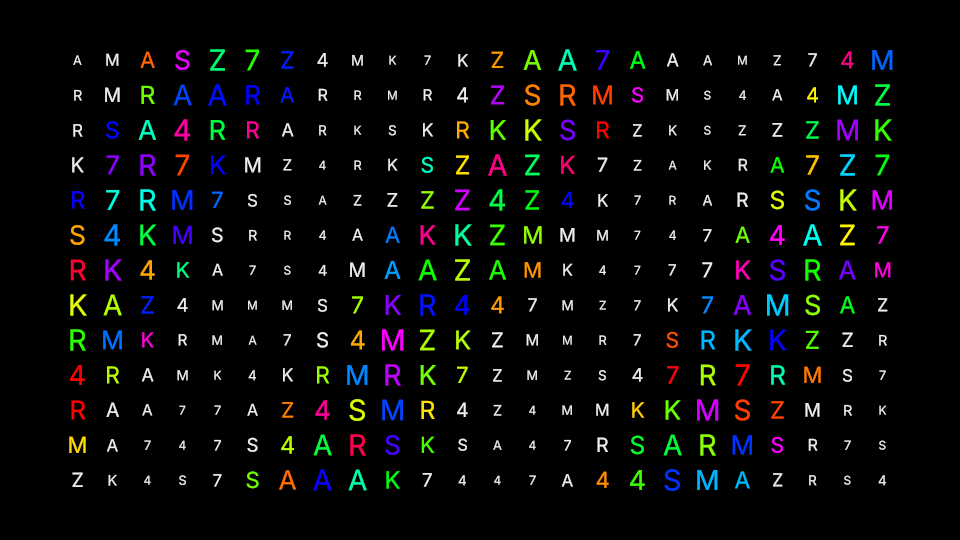

*Sopra: Wave angle 30°, Wavelength 600 px, Max labels 400.*

**Esempio: lettere dentro una lettera.** L'esempio [Sketch](esempi.md#sketch), costruito lì passo
per passo.

| By strength | Gradient (bianco, arancio, magenta, viola) |
|---|---|
| 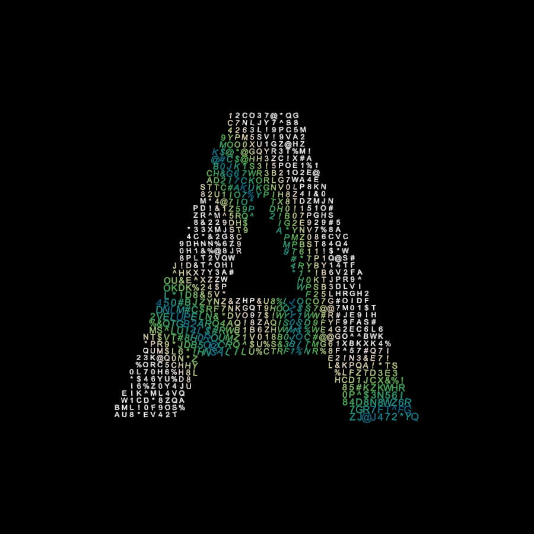 | 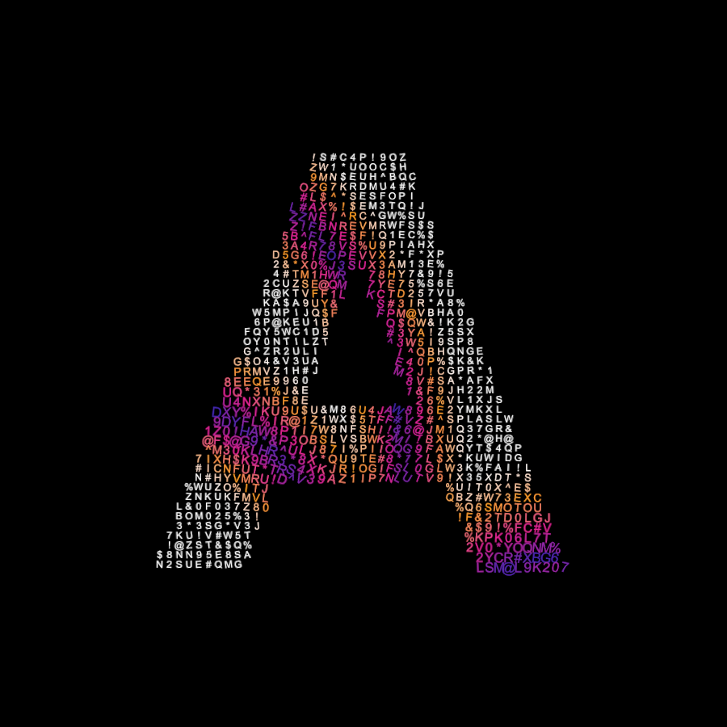 |

---

## La rampa

Conical gradient, Sweep gradient, Gradient map e Voronoi hanno le stesse righe di rampa:

| Parametro | Controllo | Intervallo | Predefinito |
|---|---|---|---|
| **Interpolation** | Menu | Linear · Smooth · Constant | Linear |
| **Stops** | Numero intero | da 2 a 5 | 3 |
| **Colour 1**, **Position 1** | Colore, slider da 0 a 100 % | | bianco, 0 |
| **Colour 2**, **Position 2** | | | ambra, 50 |
| **Colour 3**, **Position 3** | | | blu, 100 |
| **Colour 4**, **Position 4** | | | magenta, 100 |
| **Colour 5**, **Position 5** | | | nero, 100 |

- Vengono usati solo i primi **Stops** colori. Sono ordinati per Position, quindi le righe possono
  stare in qualsiasi ordine.
- *Smooth* addolcisce il passaggio tra i colori; *Constant* tiene ogni colore fino al successivo,
  per bande nette.
- **Spread** (Conical e Sweep): *Pad* mantiene i colori estremi, *Repeat* ricomincia la rampa,
  *Mirror* la fa tornare indietro.
- **Paint** (tutti i gradienti): *Inside layer* colora solo dove il layer disegna, come uno shader
  di riempimento di Cavalry; *Whole frame* riempie tutta l'immagine del layer.

Ogni riga si può animare con keyframe, pilotare con un'espressione o collegare a un driver nel node
graph.

---

## Limiti noti

- Questi effetti si installano solo in un Lumit compilato con la
  [voce Siceliot FX](modifiche-engine.md).
- Gli script di Lumit (`lumit.effect.set`) non possono impostare le righe proprie di un effetto
  LFX, solo Mix, Blend e il matte. Vanno impostate in Effect controls, con keyframe o con
  espressioni.
- La rampa ha al massimo 5 colori e il Multi-point gradient al massimo 6 punti: l'elenco delle
  righe di un LFX è fissato quando si scrive lo shader.
- Erosion arriva al massimo a 64 px, e Inner shadow sfoca con 25 campioni per direzione: con una
  Size molto grande la sfocatura può mostrare leggeri gradini.
- Un effetto LFX non può disegnare oltre l'immagine del proprio layer: lo spread di Erosion,
  Inner shadow e le ombre di Lighting restano al suo interno.
- Lighting cerca gli ostacoli con 48 campioni, quindi oggetti più sottili di Length ÷ 48 possono
  sfuggire. Bend, Wave e Four point warp spostano pixel, non tracciati: dopo di loro il contorno
  di un layer di forme non viene ridisegnato nitido.
- I bordi di Four point warp si curvano con un solo Curve ciascuno invece di due maniglie bézier.

## Per gli sviluppatori

- Sorgenti degli shader: `D:\Siceliot\extensions\src`. La rampa condivisa sta una sola volta in
  `ramp-params.wgsl`, `ramp-fns.wgsl`, `spread-params.wgsl` e `spread-fns.wgsl`; `sh build.sh` la
  inserisce in ogni effetto, scrive `extensions\siceliot\*.wgsl` e li verifica. Non modificare mai
  i file generati.
- `tools\lfx-check`: legge un'estensione esattamente come Lumit (`build_passes`) e valida ogni
  pass con naga, il compilatore usato da wgpu. Elenca le righe di ogni effetto.
- `tests\render`: `make-base.js`, `seed.ps1`, `render.js`, `chain.js`, `render2.js` e
  `render3.js` producono con `lumit-cli` le immagini di questa pagina. `showcase.sh` installa una
  copia di prova dell'estensione con alcuni valori predefiniti cambiati (elencati in
  `render3.js`), perché gli script non possono impostare le righe LFX.
